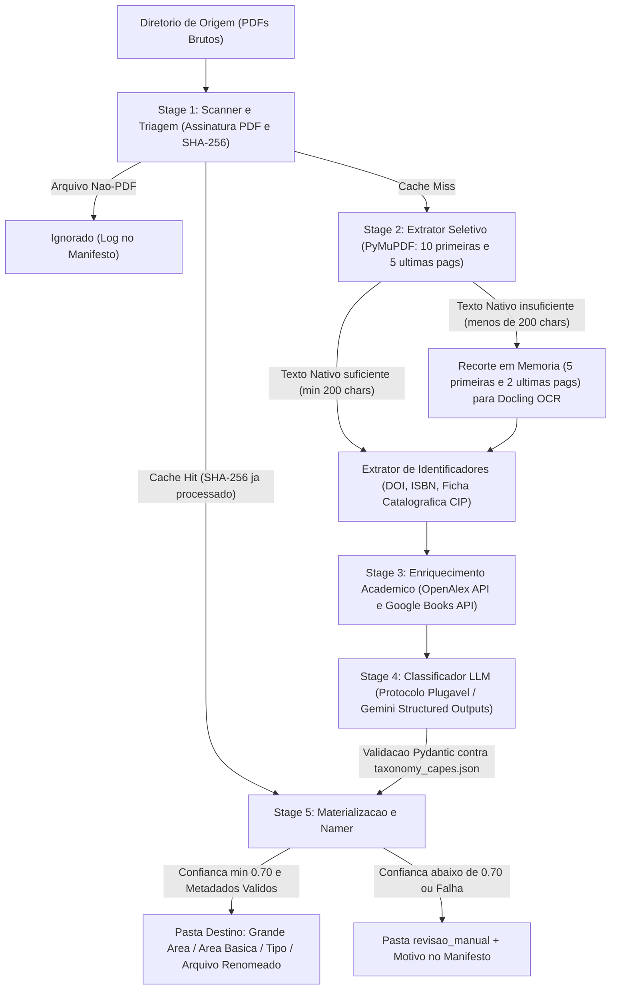

# Tomus: Organizador Acadêmico de PDFs

* **Author:** Dario
* **Date:** 2026-11-05
* **Status:** Draft

## The Problem

Estudantes, professores e pesquisadores acumulam centenas de arquivos PDF (livros, artigos científicos, fascículos de periódicos, teses, dissertações, TCCs e materiais de aula) baixados de diferentes portais acadêmicos, repositórios institucionais e pastas compartilhadas. Esses arquivos chegam com nomes arbitrários (como códigos numéricos de submissão, siglas ou títulos truncados), frequentemente não possuem metadados internos padronizados e, no caso de obras antigas ou digitalizadas, consistem apenas em imagens escaneadas sem camada de texto selecionável.

Organizar esse acervo manualmente exige abrir cada arquivo, identificar autor, título, ano, natureza da publicação e área do conhecimento, renomear o PDF e movê-lo para a pasta correspondente. À medida que a tomusa passa de dezenas para centenas de documentos, a triagem manual torna-se inviável e propensa a inconsistências.

As soluções existentes não resolvem esse fluxo diretamente no sistema de arquivos:
1. Gerenciadores bibliográficos (como Zotero e Calibre) exigem a manutenção de um banco de dados próprio e focam em metadados de citação, sem classificar automaticamente o acervo em uma árvore física de diretórios baseada nas áreas oficiais do conhecimento acadêmico brasileiro.
2. Organizadores baseados em regras fixas (como `organize-tool`) dependem de expressões regulares e metadados já preenchidos, falhando quando o arquivo não traz informações estruturadas ou quando é necessário compreender o tema da obra.
3. Organizadores experimentais baseados em modelos de linguagem (como `llama-fs`) criam categorias livremente a cada execução, gerando pastas duplicadas ou conflitantes ao longo do tempo e falhando em documentos escaneados.

## Overview

O **Tomus** é uma aplicação que automatiza a triagem, classificação temática, padronização de nomes e organização física de tomusas acadêmicas de PDFs. O sistema recebe um diretório de origem contendo arquivos desorganizados e produz, em um diretório de destino, uma tomusa estruturada em três níveis hierárquicos baseados na Tabela de Áreas do Conhecimento da CAPES/CNPq:

`<Grande Área>/<Área Básica>/<Tipo>/<autor> - <titulo> - <subtitulo> - <ano>.pdf`

Onde `<Tipo>` pertence ao conjunto fechado `{Livro, Revista Científica, Artigo, Tese_Dissertacao, Outros}`.

Para atingir esse objetivo sem depender de leitura manual nem permitir que o modelo de linguagem invente pastas fora do padrão, o Tomus combina:
* **Extração seletiva de texto e OCR local sob demanda:** Leitura das páginas iniciais e finais do PDF (onde se concentram capa, folha de rosto, resumo, ficha catalográfica ABNT/CIP e colofão), acionando OCR local (via Docling) apenas nessas páginas quando o arquivo não possui texto nativo.
* **Enriquecimento e validação externa:** Consulta a bases acadêmicas abertas (OpenAlex e Google Books) a partir de identificadores extraídos (DOI, ISBN) ou busca validada por título e autor.
* **Classificação controlada por esquema fechado:** Uso de modelo de linguagem externo (inicialmente Gemini API, com suporte a outros provedores via chave de API do usuário) restrito ao catálogo oficial da CAPES/CNPq.
* **Segurança operacional no sistema de arquivos:** Operação padrão por cópia (com opção explícita de movimentação), modo de simulação (`--dry-run`), cache local por hash para evitar reprocessamento e envio de documentos de baixa confiança para uma pasta dedicada (`revisao_manual/`) acompanhada de relatório de auditoria.

A entrega inicial foca em uma interface de linha de comando (CLI) desacoplada do motor central (`core`), permitindo validar a precisão da classificação antes da construção da interface gráfica (GUI).

## Goals

* **Classificação acadêmica padronizada (CAPES/CNPq):** Organizar automaticamente PDFs válidos na estrutura `<Grande Área>/<Área Básica>/<Tipo>`, garantindo que 100% das pastas criadas pertençam ao catálogo fechado da CAPES/CNPq e aos cinco tipos documentais definidos (`Livro`, `Revista Científica`, `Artigo`, `Tese_Dissertacao`, `Outros`).
* **Meta de precisão e controle de triagem manual:** Atingir no mínimo **80% de acerto** na classificação dos PDFs válidos do conjunto de referência (`repositorio_de_pdfs_para_testes`), mantendo o volume de arquivos enviados para `revisao_manual/` dentro de um teto máximo de **15% a 20%** dos PDFs válidos.
* **Suporte a PDFs nativos e escaneados com tempo previsível:** Extrair metadados e texto de documentos digitais e digitalizados sem processar o OCR de livros inteiros de centenas de páginas, limitando a janela de inspeção às páginas iniciais e finais.
* **Padronização determinística de nomes de arquivos:** Renomear os arquivos organizados para o formato `<autor> - <titulo> - <subtitulo> - <ano>.pdf`, aplicando regras claras para múltiplos autores, omissão de campos ausentes, sanitização de caracteres inválidos e truncamento seguro abaixo do limite de 255 bytes UTF-8 do sistema operacional.
* **Preservação dos arquivos originais e auditabilidade:** Copiar arquivos por padrão (movendo apenas quando instruído por flag), ignorar arquivos que não sejam PDFs válidos (como `.webloc` e `.DS_Store`), evitar sobrescrita de arquivos distintos e gerar um manifesto detalhado de execução.
* **Arquitetura extensível (Provedores de LLM e futura GUI):** Isolar o motor de processamento da interface CLI e permitir a configuração de diferentes provedores de LLM mediante chave de API do usuário.

## Non-Goals

* **Interface gráfica (GUI) no MVP:** A primeira versão não incluirá interface desktop ou web; toda a interação inicial ocorrerá via CLI para validar o motor de classificação.
* **OCR integral ou indexação full-text:** O sistema não fará OCR do corpo completo de livros escaneados nem construirá um motor de busca textual sobre o conteúdo integral das obras.
* **Gerenciamento de citações e leitura de PDF:** O Tomus não substituirá leitores de PDF, ferramentas de anotação ou plugins de citação para Word/LaTeX.
* **Alteração binária interna dos PDFs:** O sistema não reescreverá metadados XMP/Info dentro do binário do arquivo PDF nem modificará seu conteúdo visual.


## Technical Plan

### 1. System Architecture & Data Flow

O sistema é dividido em duas camadas: o motor central (`tomus.core`), que executa o pipeline de processamento sem acoplamento com terminal ou interface visual, e a camada de apresentação (`tomus.cli`), que consome os eventos do motor e exibe o progresso ao usuário.



### 2. Core Pipeline Stages

#### Stage 1: Scanner, Validação Binária e Cache (`tomus.core.scanner` & `tomus.core.cache`)
* **Filtro de Entrada:** Varre o diretório de origem de forma **recursiva por padrão** (`--recursive`), permitindo modo plano opcional (`--flat`). Ignora arquivos ocultos (`.DS_Store`) e extensões diferentes de `.pdf` (case-insensitive, como `.webloc`).
* **Verificação de Cabeçalho:** Lê os primeiros 1024 bytes do arquivo para confirmar a assinatura mágica `%PDF-`. Arquivos com extensão `.pdf` sem essa assinatura são registrados como corrompidos/inválidos e enviados para `revisao_manual/`.
* **Cache de Idempotência (SQLite):** Calcula o hash `SHA-256` do arquivo e consulta o banco local (`~/.cache/tomus/state.db` ou caminho configurável). Se o hash já possuir classificação válida para a mesma versão da taxonomia, reutiliza o resultado sem chamar OCR, APIs externas ou LLM.

#### Stage 2: Extração Seletiva de Texto e Fallback de OCR (`tomus.extractors`)
* **Inspeção Nativa (`native_pdf.py`):** Abre o documento via `PyMuPDF` (`fitz`) e extrai o texto das **10 primeiras páginas** e das **5 últimas páginas** (sem duplicar índices em documentos com menos de 15 páginas), além do dicionário de metadados interno do PDF (`/Title`, `/Author`, `/Subject`) e a contagem total de páginas.
* **Priorização de Ficha Catalográfica (CIP):** Verifica cada página extraída contra marcadores de catalogação na publicação (`Ficha catalográfica`, `Dados Internacionais de Catalogação`, `CDD`, `CDU`, `ISBN`, `Tomusári`). Se detectada, o texto dessa página é isolado em um bloco prioritário `cip_text` dentro do contexto do documento.
* **Critério de Acionamento do Docling (`ocr_docling.py`):** Se a soma de caracteres alfanuméricos extraídos nativamente nas páginas inspecionadas for inferior a **200 caracteres**, o documento é classificado como escaneado.
* **Recorte antes do OCR:** Para evitar que o Docling processe centenas de páginas em memória, o `PyMuPDF` cria um novo PDF temporário em memória (`io.BytesIO`) contendo exclusivamente as **5 primeiras páginas** e as **2 últimas páginas** do arquivo original. Esse documento reduzido (máximo de 7 páginas) é entregue ao `DocumentConverter` do Docling para OCR e extração em Markdown.

#### Stage 3: Extração de Identificadores e Enriquecimento Acadêmico (`tomus.enrichers`)
* **Identificadores (`identifiers.py`):** Aplica expressões regulares sobre o texto extraído e o nome do arquivo para localizar:
  * **DOI:** Padrão `10.\d{4,9}/[-._;()/:A-Z0-9]+` (normalizado em minúsculas e limpo de pontuação final).
  * **ISBN-10 / ISBN-13:** Sequências numéricas precedidas ou não por `ISBN`, validadas por cálculo de dígito verificador módulo 11 (ISBN-10) ou módulo 10 (ISBN-13) para descartar números aleatórios ou códigos de submissão no nome do arquivo (como `531581939-...`).
* **Cliente OpenAlex (`openalex.py`):**
  * Se houver DOI válido, consulta `GET https://api.openalex.org/works/https://doi.org/{doi}` com cabeçalho `User-Agent` contendo `mailto:` (Polite Pool, até 10 requisições/segundo).
  * Se não houver DOI, mas houver candidato claro de título nas páginas iniciais, realiza busca `GET https://api.openalex.org/works?search={titulo}` e só aceita o primeiro resultado se a similaridade textual (`rapidfuzz.fuzz.token_set_ratio`) entre o título consultado e o retornado for **$\ge 88$**.
* **Cliente Google Books (`google_books.py`):**
  * Se houver ISBN válido, consulta `GET https://www.googleapis.com/books/v1/volumes?q=isbn:{isbn}` (anexando `&key={google_books_api_key}` quando configurada pelo usuário para elevar a cota diária de requisições).
  * Se não houver ISBN nem match no OpenAlex, realiza busca por título/autor e aplica a mesma trava de similaridade **$\ge 88$**.
* **Resiliência:** Timeouts de 8 segundos por requisição e até 3 tentativas com *exponential backoff* (`tenacity`) para erros HTTP 429 ou 5xx. Falhas de rede não interrompem o pipeline; o documento segue para o Stage 4 apenas com o texto extraído localmente.

#### Stage 4: Classificação via LLM e Catálogo Fechado CAPES/CNPq (`tomus.llm` & `tomus.core.taxonomy`)
* **Catálogo CAPES/CNPq (`taxonomy_capes.json`):** Arquivo estático embutido no pacote contendo as **9 Grandes Áreas** oficiais da CAPES/CNPq e suas respectivas **Áreas Básicas** (ex.: `"Ciências Humanas": ["Filosofia", "Sociologia", "Antropologia", "Arqueologia", "História", "Geografia", "Psicologia", "Educação", "Ciência Política", "Teologia"]`, `"Ciências Sociais Aplicadas": ["Direito", "Administração", "Economia", "Arquitetura e Urbanismo", "Planejamento Urbano e Regional", "Demografia", "Ciência da Informação", "Museologia", "Comunicação", "Serviço Social", "Economia Doméstica", "Desenho Industrial", "Turismo"]`, etc.).
* **Protocolo Plugável (`LLMProvider`):** Interface abstrata com o método `classify(context: DocumentContext) -> LLMClassificationOutput`.
  * **Implementação Padrão (`GeminiProvider`):** Usa o SDK `google-genai` (modelo padrão `gemini-2.5-flash`, configurável via CLI/env) com `response_schema` vinculado ao modelo Pydantic `LLMClassificationOutput`.
  * **Extensibilidade:** Suporte à injeção de outros provedores (OpenAI, Anthropic) implementando o mesmo protocolo e lendo a respectiva chave de API (`GEMINI_API_KEY`, `OPENAI_API_KEY`, `ANTHROPIC_API_KEY` ou parâmetro `--api-key`).
* **Validação Estrutural e Regras de Tipo:**
  * O schema Pydantic exige que `grande_area` pertença às chaves de `taxonomy_capes.json` e que `area_basica` pertença à lista vinculada àquela `grande_area`. Caso o LLM retorne uma `area_basica` pertencente a outra `grande_area`, o validador corrige automaticamente a `grande_area` pai com base no dicionário canônico.
  * O campo `tipo` é um `Enum` estrito com cinco valores:
    1. `Livro`: Obras monográficas completas, livros-texto, coletâneas organizadas em formato de livro (geralmente com ISBN, sumário de capítulos ou $> 60$ páginas).
    2. `Revista Científica`: Edição ou fascículo completo de um periódico contendo múltiplos artigos e expediente editorial.
    3. `Artigo`: Artigo científico individual publicado em periódico ou anais de congresso, ensaio acadêmico ou revisão de literatura avulsa.
    4. `Tese_Dissertacao`: Teses de doutorado, dissertações de mestrado, trabalhos de conclusão de curso (TCC) e monografias acadêmicas de graduação/especialização.
    5. `Outros`: Slides de apresentações/aulas, apostilas institucionais, cartilhas técnicas, relatórios ou ementas que não se enquadram nos quatro tipos anteriores.
* **Cálculo de Confiança (`confidence_score`):**
  * O LLM fornece uma nota de confiança base entre `0.0` e `1.0` acompanhada de justificativa curta (`reasoning`).
  * O sistema aplica travas determinísticas sobre essa nota:
    * Se o texto útil total (após tentativa de OCR) for $< 50$ caracteres e não houver metadados externos, a confiança é forçada para `0.0`.
    * Se `titulo` for vazio ou genérico (ex.: `"Sem Título"`, `"Microsoft PowerPoint - ..."`) sem autor identificável, o teto da confiança é limitado a `0.50`.
  * Documentos com `confidence_score >= 0.70` são aprovados para organização; documentos com `< 0.70` são roteados para `revisao_manual/`.

#### Stage 5: Padronização de Nomes, Materialização e Auditoria (`tomus.storage`)
* **Formatação do Nome (`namer.py`):**
  * **Autores (`<autor>`):**
    * 1 autor: `Sobrenome, Nome` (ex.: `Chiavenato, Idalberto`).
    * 2 autores: `Sobrenome1; Sobrenome2` (ex.: `Bock; Furtado`).
    * 3 ou mais autores: `Sobrenome1 et al.` (ex.: `Rodrigues et al.`).
    * Autor institucional ou desconhecido: Nome da instituição (ex.: `Sebrae SC`) ou `Autor Desconhecido`.
  * **Ano (`<ano>`):** Ano de publicação com 4 dígitos (`YYYY`) ou `s.d.` quando ausente.
  * **Composição:**
    * Com subtítulo: `<autor> - <titulo> - <subtitulo> - <ano>.pdf`
    * Sem subtítulo: `<autor> - <titulo> - <ano>.pdf`
  * **Sanitização e Truncamento em 240 Bytes UTF-8:**
    1. Normaliza a string em UTF-8 NFC, substitui caracteres proibidos (`/`, `\`, `:`, `*`, `?`, `"`, `<`, `>`, `|`, quebras de linha e tabulações) por espaço e colapsa espaços múltiplos.
    2. Mede o tamanho em bytes (`len(nome.encode("utf-8"))`). Se ultrapassar **240 bytes** (deixando 15 bytes de margem de segurança para sufixos de colisão antes do limite de 255 bytes do APFS/ext4/NTFS):
       * Primeiro, trunca `<subtitulo>` em fronteira de palavra adicionando `...` (ou remove `<subtitulo>` inteiro se ainda exceder).
       * Se mesmo sem `<subtitulo>` o tamanho ultrapassar 240 bytes, trunca `<titulo>` em fronteira de palavra preservando `<autor>` e `<ano>` intactos.
* **Operação de Arquivo (`organizer.py`):**
  * No modo padrão, copia o arquivo via `shutil.copy2` (preservando timestamps). Se a flag `--move` for informada, move via transação segura (cópia verificada seguida de remoção da origem).
  * **Tratamento de Colisões:** Se o caminho de destino já existir:
    * Compara o `SHA-256` do arquivo existente com o atual. Se forem idênticos, registra o status `DUPLICATE_SKIPPED` e não cria cópia redundante.
    * Se os hashes forem diferentes (obras distintas com mesmo autor/título/ano), anexa sufixo incremental antes da extensão: ` (2).pdf`, ` (3).pdf`.
  * **Roteamento para `revisao_manual/`:** Arquivos com confiança $< 0.70$, PDFs corrompidos ou falhas irrecuperáveis de API são copiados/movidos com seu nome original para `<destino>/revisao_manual/`.
* **Manifesto e Auditoria:** Ao final da execução (inclusive em `--dry-run`), grava no diretório de destino:
  * `manifest.json`: Registro completo de cada arquivo inspecionado (caminho original, hash SHA-256, páginas lidas, se usou Docling OCR, dados de OpenAlex/Google Books, classificação CAPES/CNPq, score de confiança, justificativa do LLM, caminho final e status).
  * `revisao_manual/relatorio_revisao.md`: Resumo legível listando apenas os arquivos enviados para `revisao_manual/`, o motivo exato e a classificação sugerida pelo modelo para facilitar a decisão humana.

### 3. Data Models (Pydantic Schemas)

```python
from enum import Enum
from pathlib import Path
from typing import Optional
from pydantic import BaseModel, Field

class DocumentType(str, Enum):
    LIVRO = "Livro"
    REVISTA_CIENTIFICA = "Revista Científica"
    ARTIGO = "Artigo"
    TESE_DISSERTACAO = "Tese_Dissertacao"
    OUTROS = "Outros"

class ProcessStatus(str, Enum):
    ORGANIZED = "organized"
    MANUAL_REVIEW = "manual_review"
    DUPLICATE_SKIPPED = "duplicate_skipped"
    IGNORED_NON_PDF = "ignored_non_pdf"
    ERROR = "error"

class ExtractedDocument(BaseModel):
    source_path: Path
    sha256: str
    file_size_bytes: int
    total_pages: int
    used_ocr: bool
    native_metadata: dict[str, str]
    sampled_text: str
    cip_text: Optional[str] = None
    detected_doi: Optional[str] = None
    detected_isbn: Optional[str] = None

class ExternalMetadata(BaseModel):
    source: str  # "openalex" | "google_books"
    title: str
    subtitle: Optional[str] = None
    authors: list[str] = Field(default_factory=list)
    publication_year: Optional[int] = None
    document_type_hint: Optional[str] = None
    concepts: list[str] = Field(default_factory=list)
    match_score: float  # 100.0 for exact DOI/ISBN, >= 88.0 for fuzzy title

class LLMClassificationOutput(BaseModel):
    grande_area: str
    area_basica: str
    tipo: DocumentType
    authors: list[str] = Field(description="Lista de autores no formato 'Sobrenome, Nome'")
    title: str
    subtitle: Optional[str] = None
    year: Optional[str] = Field(default=None, description="Ano YYYY ou None se desconhecido")
    confidence_score: float = Field(ge=0.0, le=1.0)
    reasoning: str
```

### 4. User Configuration File (`config.toml`) & Precedence Rules

Para evitar que o usuário precise repetir parâmetros e chaves de API a cada execução no terminal (e já preparar a persistência de preferências para a futura GUI), o Tomus utiliza um arquivo de configuração em formato **TOML** com comentários explicativos.

* **Ordem de Precedência (da maior para a menor prioridade):**
  1. Flags passadas diretamente na CLI (ex.: `--move`, `--provider`, `--api-key`).
  2. Variáveis de ambiente (`TOMUS_LLM_API_KEY`, `GEMINI_API_KEY`, `OPENAI_API_KEY`, `ANTHROPIC_API_KEY`, `GOOGLE_BOOKS_API_KEY`).
  3. Arquivo de configuração local no diretório atual (`./tomus.toml`) ou informada via `--config <caminho>`.
  4. Arquivo de configuração global do usuário (`~/.config/tomus/config.toml`), criado automaticamente com permissão restrita ao usuário (`chmod 600`) pelo comando `tomus config init`.

```toml
# ~/.config/tomus/config.toml (ou ./tomus.toml)

[general]
# Modo de varredura da pasta de origem: true = recursivo (padrão), false = plano
recursive = true
# Operação padrão nos arquivos: "copy" (copiar) ou "move" (mover)
file_operation = "copy"
# Limiar mínimo de confiança (0.0 a 1.0) para organizar automaticamente; abaixo disso vai para revisao_manual/
confidence_min = 0.70
# Número de arquivos processados em paralelo
workers = 4
# Ativar cache local SQLite por SHA-256
use_cache = true

[llm]
# Provedor padrão: "gemini" | "openai" | "anthropic"
provider = "gemini"
# Modelo padrão do provedor escolhido
model = "gemini-2.5-flash"

[api_keys]
# Chaves de API do provedor de LLM e serviços de busca acadêmica
gemini_api_key = ""
openai_api_key = ""
anthropic_api_key = ""
google_books_api_key = ""
# E-mail opcional para uso do Polite Pool do OpenAlex (até 10 req/s)
openalex_polite_email = ""
```

> **Proteção de Credenciais:** Sempre que `./tomus.toml` for gerado em um diretório de projeto, o sistema verifica se ele consta no `.gitignore` para evitar o envio acidental de chaves de API para repositórios Git, e aplica permissões `0600` (leitura/escrita apenas pelo proprietário) em `~/.config/tomus/config.toml`.

### 5. CLI Contract (`tomus`)

```text
Comandos Principais:
  tomus organize <SOURCE_DIR> <TARGET_DIR> [OPTIONS]
  tomus config init [--local]      Cria o arquivo config.toml comentado (em ~/.config/tomus/ ou ./tomus.toml)
  tomus config show                Exibe a configuração ativa (mascarando as chaves de API)
  tomus config path                Exibe o caminho do arquivo de configuração carregado

Opções de `tomus organize`:
  --config PATH            Caminho para um arquivo config.toml customizado
  --recursive / --flat     Varrer subpastas da origem recursivamente ou apenas nível raiz (Padrão: --recursive)
  --move / --copy          Mover arquivos em vez de copiar (Padrão: --copy)
  --dry-run                Executa extração e classificação e gera manifest.json sem copiar/mover arquivos
  --provider TEXT          Provedor de LLM: gemini | openai | anthropic (Sobrescreve config.toml)
  --model TEXT             Nome do modelo (Sobrescreve config.toml)
  --api-key TEXT           Chave de API do provedor LLM (Sobrescreve config.toml e variáveis de ambiente)
  --google-books-key TEXT  Chave de API do Google Books (Sobrescreve config.toml)
  --confidence-min FLOAT   Limiar mínimo para organização automática (Padrão: 0.70)
  --no-cache               Ignorar o cache SQLite local e reprocessar todos os arquivos
  --workers INT            Número de arquivos processados em paralelo nas etapas de I/O e API (Padrão: 4)
```


## Alternatives Considered

### 1. Gerenciadores Bibliográficos Tradicionais (Zotero com ZotMoov/Attanger ou Calibre)
* **Descrição:** Utilizar o Zotero ou o Calibre como motor principal para importar os PDFs, buscar metadados em bases acadêmicas e mover os arquivos no disco por meio de plugins de renomeação e pastas.
* **Decisão:** Rejected by author: Embora extraiam metadados de livros e artigos com DOI/ISBN, essas ferramentas exigem manter um banco de dados próprio de gerenciador de referências, falham na extração automática de documentos brasileiros informais (como TCCs sem DOI, apostilas e slides de aula) e não classificam automaticamente o acervo em uma árvore física estrita de `<Grande Área>/<Área Básica>/<Tipo>` baseada na Tabela CAPES/CNPq.

### 2. Organizadores de Arquivos Baseados em Categorias Abertas por LLM (`llama-fs`)
* **Descrição:** Utilizar o projeto `llama-fs` para ler trechos dos PDFs e permitir que o modelo de linguagem proponha livremente a estrutura de diretórios e os nomes dos arquivos.
* **Decisão:** Rejected by author: Como o modelo inventa os nomes das pastas a cada execução com base apenas na amostra do lote atual, ocorrem variações constantes de nomenclatura e deriva de taxonomia ao longo do tempo (ex.: criação de pastas concorrentes como `Psicologia`, `Psicologia_Clinica` e `Artigos_Psicologia`). Além disso, o `llama-fs` não aplica distinção formal entre os tipos documentais acadêmicos exigidos (`Livro`, `Revista Científica`, `Artigo`, `Tese_Dissertacao`, `Outros`) e não possui fallback seletivo de OCR para PDFs escaneados.

### 3. Organizadores Baseados Exclusivamente em Regras Determinísticas (`organize-tool`)
* **Descrição:** Configurar regras declarativas em YAML no `organize-tool` inspecionando metadados internos do PDF, número de páginas e expressões regulares no texto.
* **Decisão:** Rejected by author: Regras fixas e expressões regulares não conseguem inferir semanticamente a Grande Área e a Área Básica da CAPES/CNPq a partir do conteúdo textual de livros, artigos e teses, nem conseguem normalizar títulos, subtítulos e autores quando os metadados internos do PDF estão vazios ou corrompidos.

### 4. Execução do Docling OCR no Documento PDF Inteiro
* **Descrição:** Passar o arquivo PDF completo diretamente para o `DocumentConverter` do Docling sempre que o documento precisar de extração textual ou OCR.
* **Decisão:** Rejected by author: A pasta de referência contém livros digitalizados de mais de 30 MB e centenas de páginas. Executar OCR e análise de layout página por página no livro inteiro consome gigabytes de RAM e vários minutos por arquivo, sendo que os elementos necessários para classificação e catalogação (capa, folha de rosto, ficha catalográfica ABNT/CIP, sumário, resumo e colofão) concentram-se nas páginas iniciais e finais.

### 5. Mapeamento CAPES/CNPq Usando `Área Básica / Subárea` em vez de `Grande Área / Área Básica`
* **Descrição:** Utilizar o segundo e o terceiro níveis da tabela CAPES/CNPq (`Área Básica` como primeiro nível de pasta e `Subárea` como segundo nível) em vez do primeiro e segundo níveis (`Grande Área / Área Básica`).
* **Decisão:** Rejected by author: A tabela CAPES/CNPq possui centenas de subáreas detalhadas. Adotar `Subárea` como pasta física fragmentaria acervos de médio porte (~100 a 500 PDFs) em dezenas de micro-pastas contendo apenas um ou dois arquivos e aumentaria a ambiguidade de classificação para obras interdisciplinares.


## Detailed Implementation

Abaixo está a lista unificada de todos os arquivos que serão criados para implementar o Tomus, acompanhados do que cada arquivo conterá e do motivo pelo qual é necessário:

1. **[pyproject.toml](./pyproject.toml) (Criar)**
   * **O que muda:** Define os metadados do pacote Python (`tomus`, Python $\ge 3.11$), o sistema de build (`hatchling`), o ponto de entrada executável da CLI (`tomus = "tomus.cli.main:app"`) e as dependências de produção (`pymupdf`, `docling`, `httpx`, `tenacity`, `rapidfuzz`, `pydantic`, `google-genai`, `openai`, `anthropic`, `typer`, `rich`, `tomli-w`) e de desenvolvimento (`pytest`, `pytest-asyncio`, `respx`, `ruff`).
   * **Por que é necessário:** Padroniza a instalação reproduzível do ambiente, registra o binário `tomus` no PATH do usuário e fixa as versões mínimas das tomusas de extração, OCR, rede e validação.

2. **[.gitignore](./.gitignore) (Criar)**
   * **O que muda:** Ignora ambientes virtuais (`.venv/`), caches Python (`__pycache__/`, `.pytest_cache/`, `.ruff_cache/`), arquivos de sistema (`.DS_Store`), bancos de dados SQLite locais (`*.db`), diretórios de saída de testes e o arquivo de configuração local contendo chaves de API (`tomus.toml`, `.env`).
   * **Por que é necessário:** Impede o versionamento acidental de chaves de API privadas (`gemini_api_key`, `google_books_api_key`), caches binários e artefatos temporários.

3. **[README.md](./README.md) (Criar)**
   * **O que muda:** Documenta a instalação, a configuração inicial via `tomus config init`, a estrutura de configuração do `config.toml`, os exemplos de uso de `tomus organize` (incluindo `--dry-run`, `--move`, `--flat`) e a arquitetura em 5 estágios.
   * **Por que é necessário:** Fornece instruções operacionais diretas para que o usuário configure suas chaves de API e execute a organização sobre sua tomusa.

4. **[src/tomus/__init__.py](./src/tomus/__init__.py) (Criar)**
   * **O que muda:** Define a constante `__version__ = "0.1.0"` e expõe a API pública de alto nível do pacote.
   * **Por que é necessário:** Marca `src/tomus` como pacote Python instalável e centraliza a versão usada no cabeçalho `User-Agent` das requisições externas e no cache.

5. **[src/tomus/core/__init__.py](./src/tomus/core/__init__.py) (Criar)**
   * **O que muda:** Exporta as entidades principais do domínio e o orquestrador do pipeline.
   * **Por que é necessário:** Mantém a fronteira limpa entre o motor central (`core`) e a camada de interface (`cli`, e futura `gui`).

6. **[src/tomus/core/config.py](./src/tomus/core/config.py) (Criar)**
   * **O que muda:** Define o schema Pydantic `AppConfig` (seções `general`, `llm` e `api_keys`), a lógica de resolução de precedência (flags da CLI $\rightarrow$ variáveis de ambiente $\rightarrow$ `./tomus.toml` $\rightarrow$ `~/.config/tomus/config.toml`), a geração do template TOML comentado com aplicação de permissão `0600` e o mascaramento de chaves para exibição segura.
   * **Por que é necessário:** Materializa a configuração amigável em arquivo sem exigir que o usuário passe chaves de API e parâmetros repetitivos a cada execução na linha de comando.

7. **[src/tomus/core/models.py](./src/tomus/core/models.py) (Criar)**
   * **O que muda:** Declara os enumeradores (`DocumentType`, `ProcessStatus`, `FileOperation`) e os modelos de dados Pydantic (`ExtractedDocument`, `ExternalMetadata`, `LLMClassificationOutput`, `FileManifestEntry`, `ExecutionSummary`, `PipelineEvent`).
   * **Por que é necessário:** Garante contratos de dados fortemente tipados entre todas as etapas do pipeline e fornece o schema exato exigido pelo modo *Structured Outputs* dos provedores de LLM.

8. **[src/tomus/core/resources/taxonomy_capes.json](./src/tomus/core/resources/taxonomy_capes.json) (Criar)**
   * **O que muda:** Armazena o dicionário canônico oficial das 9 Grandes Áreas da CAPES/CNPq mapeadas para suas respectivas listas de Áreas Básicas em português.
   * **Por que é necessário:** Atua como fonte única de verdade (imutável) para validar as pastas `<Grande Área>/<Área Básica>` e impedir que o modelo de linguagem crie categorias inexistentes ou com variações de grafia.

9. **[src/tomus/core/taxonomy.py](./src/tomus/core/taxonomy.py) (Criar)**
   * **O que muda:** Carrega `taxonomy_capes.json`, fornece funções de consulta (`get_grandes_areas()`, `get_areas_basicas()`, `validate_or_repair_pair(grande_area, area_basica)`) e formata a lista fechada de categorias para injeção no prompt do classificador.
   * **Por que é necessário:** Centraliza a validação determinística da taxonomia e corrige automaticamente a `Grande Área` caso o LLM acerte a `Área Básica` mas troque a área-mãe.

10. **[src/tomus/core/scanner.py](./src/tomus/core/scanner.py) (Criar)**
    * **O que muda:** Implementa a varredura de arquivos (recursiva por padrão via `rglob`, ou plana via `iterdir`), filtrando arquivos ocultos, registrando arquivos não-PDF (`IGNORED_NON_PDF`), validando os primeiros 1024 bytes em busca da assinatura `%PDF-` e calculando o hash `SHA-256` em blocos de 64 KB.
    * **Por que é necessário:** Evita que arquivos `.webloc`, `.DS_Store` ou PDFs corrompidos quebrem os extratores subsequentes e fornece a chave de idempotência (`SHA-256`) de cada documento.

11. **[src/tomus/core/cache.py](./src/tomus/core/cache.py) (Criar)**
    * **O que muda:** Gerencia o banco SQLite local (`state.db`) contendo a tabela `processed_files` indexada por `(sha256, taxonomy_version)`, com operações de leitura, gravação transacional e invalidação (`--no-cache`).
    * **Por que é necessário:** Garante idempotência e retomada rápida de execuções interrompidas sem gastar novamente tempo de OCR nem cota de API em arquivos já classificados.

12. **[src/tomus/extractors/__init__.py](./src/tomus/extractors/__init__.py) (Criar)**
    * **O que muda:** Expõe a função coordenadora de extração documental e os utilitários de identificadores.
    * **Por que é necessário:** Encapsula a decisão entre texto nativo e fallback de OCR sob uma única chamada para o pipeline.

13. **[src/tomus/extractors/identifiers.py](./src/tomus/extractors/identifiers.py) (Criar)**
    * **O que muda:** Contém os extratores baseados em regex para DOI e ISBN-10/ISBN-13, o validador matemático de dígito verificador de ISBN (módulo 11 e módulo 10) e o detector de páginas de Ficha Catalográfica (CIP/ABNT/CDD/CDU).
    * **Por que é necessário:** Impede que números aleatórios no nome do arquivo (como IDs de download) sejam confundidos com ISBNs e destaca a Ficha Catalográfica brasileira para o classificador.

14. **[src/tomus/extractors/native_pdf.py](./src/tomus/extractors/native_pdf.py) (Criar)**
    * **O que muda:** Utiliza `PyMuPDF` (`fitz`) para ler metadados internos e extrair texto das 10 primeiras e 5 últimas páginas do PDF, calculando a densidade de caracteres alfanuméricos úteis.
    * **Por que é necessário:** Extrai em milissegundos as páginas onde estão os metadados bibliográficos na maioria dos PDFs digitais, identificando imediatamente quando o arquivo é apenas imagem escaneada.

15. **[src/tomus/extractors/ocr_docling.py](./src/tomus/extractors/ocr_docling.py) (Criar)**
    * **O que muda:** Recebe o caminho de um PDF escaneado (com menos de 200 caracteres nativos), recorta via `PyMuPDF` apenas as 5 primeiras e 2 últimas páginas em um buffer `io.BytesIO` em memória e executa o `DocumentConverter` do Docling sobre esse sub-documento de até 7 páginas.
    * **Por que é necessário:** Viabiliza a leitura de livros e artigos escaneados sem o gargalo de memória e tempo que ocorreria ao passar obras inteiras de 300+ páginas para o Docling.

16. **[src/tomus/enrichers/__init__.py](./src/tomus/enrichers/__init__.py) (Criar)**
    * **O que muda:** Exporta o orquestrador de enriquecimento externo (`MetadataEnricherService`).
    * **Por que é necessário:** Coordena a consulta em cascata entre OpenAlex e Google Books.

17. **[src/tomus/enrichers/base.py](./src/tomus/enrichers/base.py) (Criar)**
    * **O que muda:** Define a interface abstrata dos clientes de enriquecimento e a função compartilhada de validação de similaridade textual (`rapidfuzz.fuzz.token_set_ratio >= 88.0`).
    * **Por que é necessário:** Garante que qualquer resultado buscado por título/autor passe pelo mesmo filtro anti-falso-positivo antes de ser aceito.

18. **[src/tomus/enrichers/openalex.py](./src/tomus/enrichers/openalex.py) (Criar)**
    * **O que muda:** Implementa o cliente HTTP (`httpx` + `tenacity` retry) para a API do OpenAlex, suportando busca exata por DOI, busca textual por título com validação `rapidfuzz` e uso do Polite Pool (`mailto:`).
    * **Por que é necessário:** Recupera metadados verificados de artigos científicos, periódicos e teses indexadas.

19. **[src/tomus/enrichers/google_books.py](./src/tomus/enrichers/google_books.py) (Criar)**
    * **O que muda:** Implementa o cliente HTTP (`httpx` + `tenacity` retry) para a Google Books API, suportando busca exata por ISBN válido, busca por título/autor com validação `rapidfuzz` e autenticação opcional via `google_books_api_key`.
    * **Por que é necessário:** Recupera título, subtítulo, autores e ano de publicação de livros acadêmicos e comerciais.

20. **[src/tomus/llm/__init__.py](./src/tomus/llm/__init__.py) (Criar)**
    * **O que muda:** Exporta a fábrica de provedores `create_llm_provider(config: AppConfig)`.
    * **Por que é necessário:** Desacopla o pipeline da implementação concreta do SDK de cada fornecedor de IA.

21. **[src/tomus/llm/base.py](./src/tomus/llm/base.py) (Criar)**
    * **O que muda:** Declara o protocolo `LLMProvider` (`classify(doc: ExtractedDocument, external: list[ExternalMetadata]) -> LLMClassificationOutput`) e a lógica de ajuste determinístico do `confidence_score` pós-classificação.
    * **Por que é necessário:** Permite plugar Gemini, OpenAI ou Anthropic sob o mesmo contrato e aplica as travas de segurança de confiança antes de aprovar o documento.

22. **[src/tomus/llm/prompts.py](./src/tomus/llm/prompts.py) (Criar)**
    * **O que muda:** Constrói o prompt de sistema e o payload contextual contendo as regras de distinção entre `Livro`, `Revista Científica`, `Artigo`, `Tese_Dissertacao` e `Outros`, as regras de formatação de autores (`Sobrenome, Nome`), a priorização da Ficha Catalográfica e a tabela fechada CAPES/CNPq.
    * **Por que é necessário:** Concentra as instruções de classificação em um único módulo auditável e compartilhado entre todos os provedores de LLM.

23. **[src/tomus/llm/gemini.py](./src/tomus/llm/gemini.py) (Criar)**
    * **O que muda:** Implementa `GeminiProvider` usando o SDK `google-genai` com configuração `response_mime_type="application/json"` e `response_schema=LLMClassificationOutput`, incluindo retry com backoff para limites de taxa (HTTP 429).
    * **Por que é necessário:** Fornece o classificador padrão do MVP garantindo saída JSON aderente ao schema Pydantic.

24. **[src/tomus/llm/openai_provider.py](./src/tomus/llm/openai_provider.py) (Criar)**
    * **O que muda:** Implementa `OpenAIProvider` usando Structured Outputs (`beta.chat.completions.parse`) e `ANTHROPIC_API_KEY` / `OPENAI_API_KEY` conforme configurado em `config.toml`.
    * **Por que é necessário:** Cumpre o requisito de permitir que o usuário utilize provedores alternativos caso possua chave de API própria.

25. **[src/tomus/storage/__init__.py](./src/tomus/storage/__init__.py) (Criar)**
    * **O que muda:** Exporta o formatador de nomes (`FileNamer`) e o materializador de diretórios (`LibraryOrganizer`).
    * **Por que é necessário:** Agrupa as operações de escrita no sistema de arquivos.

26. **[src/tomus/storage/namer.py](./src/tomus/storage/namer.py) (Criar)**
    * **O que muda:** Implementa a regra de composição `<autor> - <titulo> - <subtitulo> - <ano>.pdf` (com formatação de 1, 2 ou 3+ autores, omissão de subtítulo vazio, fallback `s.d.`, sanitização de caracteres inválidos e truncamento progressivo em fronteira de palavra garantindo tamanho $\le 240$ bytes em UTF-8 NFC).
    * **Por que é necessário:** Impede falhas de sistema operacional por nomes de arquivo longos demais (`ENAMETOOLONG`) ou caracteres proibidos em títulos acadêmicos.

27. **[src/tomus/storage/organizer.py](./src/tomus/storage/organizer.py) (Criar)**
    * **O que muda:** Cria a árvore `<TARGET_DIR>/<Grande Área>/<Área Básica>/<Tipo>/` e `<TARGET_DIR>/revisao_manual/`, executa cópia (`shutil.copy2`) ou movimentação segura, resolve colisões comparando `SHA-256` (pulando duplicatas exatas ou adicionando ` (2).pdf` para arquivos distintos) e grava `manifest.json` e `revisao_manual/relatorio_revisao.md`.
    * **Por que é necessário:** Garante que nenhum arquivo original seja perdido ou sobrescrito silenciosamente e entrega rastreabilidade completa das decisões tomadas.

28. **[src/tomus/core/pipeline.py](./src/tomus/core/pipeline.py) (Criar)**
    * **O que muda:** Conecta os 5 estágios (Scanner $\rightarrow$ Extrator/Docling $\rightarrow$ Enrichers $\rightarrow$ LLM $\rightarrow$ Organizer), gerencia o pool de execução concorrente (`workers`), aplica a verificação do teto de alerta para `revisao_manual/` (15–20%) e emite callbacks de progresso (`on_file_start`, `on_file_complete`, `on_summary`).
    * **Por que é necessário:** Orquestra todo o fluxo de ponta a ponta de forma independente da interface de usuário.

29. **[src/tomus/cli/__init__.py](./src/tomus/cli/__init__.py) (Criar)**
    * **O que muda:** Inicializa o módulo de linha de comando.
    * **Por que é necessário:** Estrutura o subpacote de interface de terminal.

30. **[src/tomus/cli/main.py](./src/tomus/cli/main.py) (Criar)**
    * **O que muda:** Implementa os comandos `tomus organize`, `tomus config init`, `tomus config show` e `tomus config path` usando `Typer` e `Rich` (barras de progresso, tabela final de métricas com contagem de organizados, duplicatas, ignorados e taxa de `revisao_manual`).
    * **Por que é necessário:** Entrega a interface operacional do MVP permitindo uso imediato no terminal.

31. **[tests/test_namer.py](./tests/test_namer.py) (Criar)**
    * **O que muda:** Testes unitários cobrindo 1, 2 e 3+ autores, ausência de subtítulo/ano, caracteres especiais e truncamento exato abaixo de 240 bytes UTF-8 com caracteres acentuados.
    * **Por que é necessário:** Prova matematicamente que nenhum título longo ou acentuado violará o limite de 255 bytes do sistema de arquivos.

32. **[tests/test_taxonomy_and_identifiers.py](./tests/test_taxonomy_and_identifiers.py) (Criar)**
    * **O que muda:** Testes unitários validando a integridade de `taxonomy_capes.json`, o reparo automático de `Grande Área`, a extração de DOI, o cálculo de dígito verificador de ISBN-10/13 (rejeitando falsos números como `531581939`) e a detecção de Ficha Catalográfica.
    * **Por que é necessário:** Garante que a taxonomia fechada nunca sofra deriva e que identificadores inválidos não disparem buscas erradas nas APIs.

33. **[tests/test_pipeline_integration.py](./tests/test_pipeline_integration.py) (Criar)**
    * **O que muda:** Testes de integração simulando o pipeline completo (incluindo filtro de `.webloc`, recorte de páginas para OCR, deduplicação por `SHA-256`, modo `--dry-run`, cache SQLite e roteamento para `revisao_manual/`) e script de avaliação sobre `repositorio_de_pdfs_para_testes`.
    * **Por que é necessário:** Verifica o funcionamento integrado dos 5 estágios e valida a meta de $\ge 80\%$ de acerto nos arquivos reais de teste.
