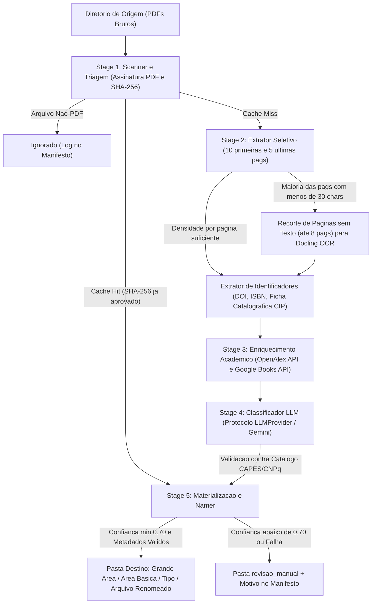

# BiblioTEC: Organizador Acadêmico de PDFs

* **Author:** Dario
* **Date:** 2026-11-05
* **Status:** Approved

## The Problem

Estudantes, professores e pesquisadores acumulam centenas de arquivos PDF (livros, artigos científicos, fascículos de periódicos, teses, dissertações, TCCs e materiais de aula) baixados de diferentes portais acadêmicos, repositórios institucionais e pastas compartilhadas. Esses arquivos chegam com nomes arbitrários (como códigos numéricos de submissão, siglas ou títulos truncados), frequentemente não possuem metadados internos padronizados e, no caso de obras antigas ou digitalizadas, consistem apenas em imagens escaneadas sem camada de texto selecionável.

Organizar esse acervo manualmente exige abrir cada arquivo, identificar autor, título, ano, natureza da publicação e área do conhecimento, renomear o PDF e movê-lo para a pasta correspondente. À medida que a biblioteca passa de dezenas para centenas de documentos, a triagem manual torna-se inviável e propensa a inconsistências.

As soluções existentes não resolvem esse fluxo diretamente no sistema de arquivos:
1. Gerenciadores bibliográficos (como Zotero e Calibre) exigem a manutenção de um banco de dados próprio e focam em metadados de citação, sem classificar automaticamente o acervo em uma árvore física de diretórios baseada nas áreas oficiais do conhecimento acadêmico brasileiro.
2. Organizadores baseados em regras fixas (como `organize-tool`) dependem de expressões regulares e metadados já preenchidos, falhando quando o arquivo não traz informações estruturadas ou quando é necessário compreender o tema da obra.
3. Organizadores experimentais baseados em modelos de linguagem (como `llama-fs`) criam categorias livremente a cada execução, gerando pastas duplicadas ou conflitantes ao longo do tempo e falhando em documentos escaneados.

## Overview

O **BiblioTEC** é uma aplicação que automatiza a triagem, classificação temática, padronização de nomes e organização física de bibliotecas acadêmicas de PDFs. O sistema recebe um diretório de origem contendo arquivos desorganizados e produz, em um diretório de destino, uma biblioteca estruturada em três níveis hierárquicos baseados na Tabela de Áreas do Conhecimento da CAPES/CNPq:

`<Grande Área>/<Área Básica>/<Tipo>/<autor> - <titulo> - <subtitulo> - <ano>.pdf`

Onde `<Tipo>` pertence ao conjunto fechado `{Livro, Revista Científica, Artigo, Tese_Dissertacao, Outros}`.

Para atingir esse objetivo sem depender de leitura manual nem permitir que o modelo de linguagem invente pastas fora do padrão, o BiblioTEC combina:
* **Extração seletiva de texto e OCR local sob demanda:** Leitura das páginas iniciais e finais do PDF (onde se concentram capa, folha de rosto, resumo, ficha catalográfica ABNT/CIP e colofão), acionando OCR local (via Docling) apenas nas páginas sem texto dessa janela quando o arquivo é escaneado.
* **Enriquecimento e validação externa:** Consulta a bases acadêmicas abertas (OpenAlex e Google Books) a partir de identificadores extraídos (DOI, ISBN) ou busca validada por título e autor.
* **Classificação controlada por esquema fechado:** Uso de modelo de linguagem externo (Gemini API no MVP, detrás de um protocolo extensível) restrito ao catálogo oficial da CAPES/CNPq.
* **Segurança operacional no sistema de arquivos:** Operação padrão por cópia (com opção explícita de movimentação), modo de simulação (`--dry-run`), cache local por hash para evitar reprocessamento e envio de documentos de baixa confiança para uma pasta dedicada (`revisao_manual/`) acompanhada de relatório de auditoria.

A entrega inicial foca em uma interface de linha de comando (CLI) desacoplada do motor central (`core`), permitindo validar a precisão da classificação antes da construção da interface gráfica (GUI).

## Goals

* **Classificação acadêmica padronizada (CAPES/CNPq):** Organizar automaticamente PDFs válidos na estrutura `<Grande Área>/<Área Básica>/<Tipo>`, garantindo que 100% das pastas criadas pertençam ao catálogo fechado da CAPES/CNPq e aos cinco tipos documentais definidos (`Livro`, `Revista Científica`, `Artigo`, `Tese_Dissertacao`, `Outros`).
* **Meta de precisão e controle de triagem manual:** Atingir no mínimo **80% de acerto** na classificação dos PDFs válidos do conjunto de referência (`repositorio_de_pdfs_para_testes`), mantendo o volume de arquivos enviados para `revisao_manual/` dentro de um teto máximo de **15% a 20%** dos PDFs válidos.
* **Suporte a PDFs nativos e escaneados com tempo previsível:** Extrair metadados e texto de documentos digitais e digitalizados sem processar o OCR de livros inteiros de centenas de páginas, limitando a janela de inspeção às páginas iniciais e finais.
* **Padronização determinística de nomes de arquivos:** Renomear os arquivos organizados para o formato `<autor> - <titulo> - <subtitulo> - <ano>.pdf`, aplicando regras determinísticas para múltiplos autores, omissão de campos ausentes, sanitização de caracteres inválidos e truncamento no limite máximo de **240 bytes UTF-8** (abaixo do limite de 255 bytes do sistema operacional).
* **Preservação dos arquivos originais e auditabilidade:** Copiar arquivos por padrão (movendo apenas quando instruído por flag), ignorar arquivos que não sejam PDFs válidos (como `.webloc` e `.DS_Store`), evitar sobrescrita de arquivos distintos e gerar um manifesto detalhado de execução.
* **Arquitetura extensível (Protocolo de LLM e futura GUI):** Isolar o motor de processamento da interface CLI e definir uma fronteira limpa (`LLMProvider`) implementada inicialmente com Gemini API.

## Non-Goals

* **Interface gráfica (GUI) no MVP:** A primeira versão não incluirá interface desktop ou web; toda a interação inicial ocorrerá via CLI para validar o motor de classificação.
* **Suporte nativo a múltiplos SDKs de LLM no lançamento:** Provedores adicionais (OpenAI, Anthropic) não serão empacotados no MVP até que o pipeline principal com Gemini atinja a meta de precisão.
* **OCR integral ou indexação full-text:** O sistema não fará OCR do corpo completo de livros escaneados nem construirá um motor de busca textual sobre o conteúdo integral das obras.
* **Gerenciamento de citações e leitura de PDF:** O BiblioTEC não substituirá leitores de PDF, ferramentas de anotação ou plugins de citação para Word/LaTeX.
* **Alteração binária interna dos PDFs:** O sistema não reescreverá metadados XMP/Info dentro do binário do arquivo PDF nem modificará seu conteúdo visual.

## Technical Plan

### 1. System Architecture & Data Flow

O sistema é dividido em duas camadas: o motor central (`bibliotec.core`), que executa o pipeline de processamento sem acoplamento com terminal ou interface visual, e a camada de apresentação (`bibliotec.cli`), que consome os eventos do motor e exibe o progresso ao usuário.



### 2. Core Pipeline Stages

#### Stage 1: Scanner, Validação Binária e Cache
* **Filtro de Entrada e Exclusão de Destino:** Varre o diretório de origem de forma **recursiva por padrão** (`--recursive`), permitindo modo plano opcional (`--flat`). Antes de iniciar, resolve os caminhos absolutos de `SOURCE_DIR` e `TARGET_DIR`, rejeita execuções onde `SOURCE_DIR == TARGET_DIR` e exclui automaticamente a subárvore de `TARGET_DIR` caso ela esteja contida dentro de `SOURCE_DIR`. Ignora arquivos ocultos e extensões diferentes de `.pdf` (`ignored_non_pdf`).
* **Verificação de Cabeçalho:** Valida a assinatura binária `%PDF-` nos bytes iniciais do arquivo. Arquivos com extensão `.pdf` corrompidos ou inválidos são registrados e enviados para `revisao_manual/`.
* **Cache de Idempotência (SQLite):** Calcula o hash `SHA-256` do arquivo e consulta o banco local em `~/.cache/bibliotec/state.db` pela chave composta `(sha256, taxonomy_version, model_name)`. Apenas classificações aprovadas (`confidence_score >= confidence_min`) são persistidas no cache, permitindo que arquivos enviados anteriormente para `revisao_manual/` por falhas transitórias sejam reavaliados em execuções futuras.

#### Stage 2: Extração Seletiva de Texto e Fallback de OCR
* **Inspeção Nativa:** Extrai o texto das **10 primeiras páginas** e das **5 últimas páginas** do PDF (sem duplicar páginas em documentos curtos), além dos metadados internos e contagem total de páginas.
* **Priorização de Ficha Catalográfica (CIP):** Identifica páginas que contêm marcadores de catalogação na publicação padrão ABNT (CIP, CDD, CDU, ISBN) e destaca esse conteúdo em um campo dedicado (`cip_text`) para priorização na etapa de classificação.
* **Fallback de OCR Seletivo por Página (Docling):** Para evitar que uma única capa ou marca d'água digital de portal (ex.: JSTOR, SciELO) mascare um PDF escaneado, a densidade textual é medida **por página**: se mais da metade das páginas inspecionadas contiver menos de **30 caracteres alfanuméricos**, o extrator recorta em memória as páginas sem texto dentro da janela das **8 primeiras e 2 últimas páginas** (limitado a no máximo 8 páginas) e submete esse recorte ao OCR do Docling.
* **Execução Sequencial Padrão:** Como o Docling já paraleliza operações internamente na CPU/GPU e o SQLite opera em arquivo local, o pipeline processa os arquivos de forma sequencial por padrão (`workers = 1`). Caso o usuário configure `workers > 1`, apenas as chamadas de rede (Stage 3 e Stage 4) ocorrem em paralelo, mantendo o OCR e o bloco de persistência final (SQLite + Stage 5) serializados no orquestrador.

#### Stage 3: Extração de Identificadores e Enriquecimento Acadêmico
* **Identificadores Validados:** Localiza candidatos a DOI por expressão regular estrita e candidatos a ISBN-10/ISBN-13 validando matematicamente o dígito verificador (`python-stdnum`), descartando números arbitrários presentes em nomes de arquivos.
* **Consultas ao OpenAlex e Google Books:**
  * Consultas por DOI (OpenAlex) ou ISBN validado (Google Books) são aceitas como correspondência exata.
  * Quando não há DOI ou ISBN, o sistema realiza busca textual por título/autor e só aceita o metadado retornado se a similaridade textual entre o título extraído e o título da API atingir o limiar mínimo de **88%**.
* **Tolerância a Falhas:** Requisições externas possuem timeout de 8 segundos e até 3 retentativas automáticas para limites de taxa (HTTP 429). Se as APIs estiverem indisponíveis ou não retornarem correspondência confiável, o pipeline prossegue utilizando apenas o texto extraído do próprio PDF.

#### Stage 4: Classificação via LLM e Catálogo Fechado CAPES/CNPq
* **Catálogo CAPES/CNPq (`taxonomy_capes.json`):** Dicionário estático contendo a versão do catálogo (`version`) e as **9 Grandes Áreas** oficiais da CAPES/CNPq mapeadas para suas respectivas **Áreas Básicas**.
* **Protocolo `LLMProvider` e Orçamento de Payload:** O motor define uma interface abstrata de classificação e implementa no MVP o provedor Gemini (`gemini-2.5-flash` por padrão) utilizando saída estruturada (*Structured Outputs*). O texto amostrado (`sampled_text`) enviado ao prompt é limitado a no máximo **15.000 caracteres**, preservando integralmente `cip_text`, metadados nativos e páginas iniciais.
* **Validação da Taxonomia e Regras de Tipo:**
  * O validador garante que `grande_area` e `area_basica` pertençam ao catálogo oficial; se o modelo indicar uma `area_basica` válida sob a `grande_area` incorreta, o sistema corrige automaticamente a `grande_area` pai pelo dicionário canônico. Caso nem `area_basica` nem `grande_area` existam no catálogo, o documento recebe `confidence_score = 0.0` e segue para `revisao_manual/`.
  * O campo `tipo` admite exclusivamente cinco valores:
    1. `Livro`: Obras monográficas completas, livros-texto ou coletâneas.
    2. `Revista Científica`: Edição ou fascículo completo de um periódico contendo múltiplos artigos.
    3. `Artigo`: Artigo científico individual, ensaio acadêmico ou revisão de literatura avulsa.
    4. `Tese_Dissertacao`: Teses, dissertações, TCCs e monografias acadêmicas.
    5. `Outros`: Slides de aula, apostilas institucionais, cartilhas, relatórios ou ementas.
* **Travas de Confiança (`confidence_score`):**
  * Se o texto útil total após tentativa de OCR for inferior a 50 caracteres e não houver metadados externos, o pipeline faz *short-circuit* antes de chamar a API do LLM, atribuindo `confidence_score = 0.0`.
  * Se o título retornado for vazio ou genérico sem autor identificável, a confiança máxima é limitada a `0.50`.
  * Arquivos com `confidence_score >= 0.70` seguem para a árvore final; arquivos com `< 0.70` vão para `revisao_manual/`.

#### Stage 5: Padronização de Nomes, Materialização e Auditoria
* **Regras de Nomeação (Arquivos Aprovados):**
  * **Autores:** `Sobrenome, Nome` (1 autor), `Sobrenome1; Sobrenome2` (2 autores), `Sobrenome1 et al.` (3+ autores), ou nome institucional / `Autor Desconhecido`.
  * **Composição:** `<autor> - <titulo> - <subtitulo> - <ano>.pdf` (omitindo `<subtitulo>` quando ausente e usando `s.d.` quando o ano for desconhecido).
  * **Sanitização e Limite de 240 Bytes UTF-8:** Remove caracteres proibidos pelo sistema de arquivos e trunca progressivamente primeiro o subtítulo e depois o título (em fronteira de palavra), limitando o nome final a **240 bytes em UTF-8** e preservando `<autor>` e `<ano>`.
* **Materialização, `revisao_manual/` e Colisões:**
  * Copia os arquivos por padrão (`--copy`) ou move mediante `--move`. No modo `--dry-run`, nenhuma pasta temática é criada e nenhum PDF é copiado/movido, gravando apenas os relatórios de auditoria.
  * Arquivos enviados para `revisao_manual/` **preservam seu nome de arquivo original** (`source_path.name`).
  * Tanto na árvore temática quanto em `revisao_manual/`, se já existir um arquivo com o mesmo nome no destino, compara-se o hash `SHA-256`: duplicatas exatas são ignoradas (`duplicate_skipped`), enquanto arquivos de conteúdo distinto recebem sufixo incremental ` (2).pdf`.
* **Auditoria:** Gera no destino o manifesto completo (`manifest.json`) e o relatório legível de pendências (`revisao_manual/relatorio_revisao.md`).

### 3. Domain Entities & Data Contracts

| Entidade / Contrato | Responsabilidade | Campos Principais |
| :--- | :--- | :--- |
| **`ExtractedDocument`** | Resultado da leitura local do PDF (Stage 1 e Stage 2). | `source_path`, `sha256`, `file_size_bytes`, `total_pages`, `used_ocr`, `native_metadata`, `sampled_text`, `cip_text`, `detected_doi`, `detected_isbn` |
| **`ExternalMetadata`** | Metadados recuperados e validados do OpenAlex ou Google Books (Stage 3). | `source` (`openalex` \| `google_books`), `title`, `subtitle`, `authors`, `publication_year`, `document_type_hint`, `concepts`, `match_score` |
| **`LLMClassificationOutput`** | Contrato de saída estruturada do LLM validado contra a tabela CAPES/CNPq (Stage 4). | `grande_area`, `area_basica`, `tipo` (`DocumentType`), `authors` (`list[str]` no formato `"Sobrenome, Nome"`), `title`, `subtitle`, `year`, `confidence_score` (`0.0..1.0`), `reasoning` |
| **`FileManifestEntry`** | Registro individual auditável gravado em `manifest.json` (Stage 5). | `source_path`, `destination_path`, `sha256`, `status` (`organized`, `manual_review`, `duplicate_skipped`, `ignored_non_pdf`, `error`), `used_ocr`, `classification`, `error_message` |
| **`ExecutionSummary`** | Envelope raiz gravado em `manifest.json` e exibido ao final da CLI. | `total_scanned`, `organized_count`, `manual_review_count`, `duplicate_skipped_count`, `ignored_non_pdf_count`, `error_count`, `manual_review_ratio`, `exceeded_manual_review_ceiling`, `entries` (`list[FileManifestEntry]`) |
| **`PipelineEvent`** | Evento emitido pelo orquestrador para atualizar a interface (CLI/futura GUI). | `stage`, `source_path`, `status`, `message` |

### 4. User Configuration File (`config.toml`) & Precedence Rules

O BiblioTEC utiliza um arquivo de configuração **TOML** gerenciado via `pydantic-settings`, permitindo definir os padrões de operação e as chaves de API em um único local:

* **Ordem de Precedência (da maior para a menor prioridade):**
  1. Flags passadas diretamente na CLI (ex.: `--move`, `--flat`, `--api-key`).
  2. Variáveis de ambiente (`BIBLIOTEC_GEMINI_API_KEY` > `GEMINI_API_KEY`, `BIBLIOTEC_GOOGLE_BOOKS_API_KEY` > `GOOGLE_BOOKS_API_KEY`, `BIBLIOTEC_OPENALEX_POLITE_EMAIL` > `OPENALEX_POLITE_EMAIL`).
  3. Arquivo de configuração local no diretório atual (`./bibliotec.toml`) ou indicado via `--config <caminho>`.
  4. Arquivo de configuração global do usuário (`~/.config/bibliotec/config.toml`), gerado com permissão restrita (`0600`) pelo comando `bibliotec config init`.

```toml
# ~/.config/bibliotec/config.toml (ou ./bibliotec.toml)

[general]
# Modo de varredura da pasta de origem: true = recursivo (padrão), false = plano
recursive = true
# Operação padrão nos arquivos: "copy" (copiar) ou "move" (mover)
file_operation = "copy"
# Limiar mínimo de confiança (0.0 a 1.0) para organizar automaticamente
confidence_min = 0.70
# Número de workers (1 = execução sequencial padrão segura para OCR e SQLite)
workers = 1
# Ativar cache local SQLite por SHA-256 (~/.cache/bibliotec/state.db)
use_cache = true

[llm]
# Provedor de classificação (MVP implementa "gemini")
provider = "gemini"
# Modelo padrão do provedor
model = "gemini-2.5-flash"

[api_keys]
# Chaves de API do provedor de LLM e serviços de busca acadêmica
gemini_api_key = ""
google_books_api_key = ""
# E-mail opcional para uso do Polite Pool do OpenAlex (até 10 req/s)
openalex_polite_email = ""
```

### 5. CLI Contract (`bibliotec`)

```text
Comandos Principais:
  bibliotec organize <SOURCE_DIR> <TARGET_DIR> [OPTIONS]
  bibliotec config init [--local]      Cria o arquivo config.toml comentado (em ~/.config/bibliotec/ ou ./bibliotec.toml)
  bibliotec config show                Exibe a configuração ativa (mascarando as chaves de API)
  bibliotec config path                Exibe o caminho do arquivo de configuração carregado

Opções de `bibliotec organize`:
  --config PATH            Caminho para um arquivo config.toml customizado
  --recursive / --flat     Varrer subpastas da origem recursivamente ou apenas nível raiz (Padrão: --recursive)
  --move / --copy          Mover arquivos em vez de copiar (Padrão: --copy)
  --dry-run                Executa extração e classificação e gera manifest.json sem copiar/mover arquivos
  --model TEXT             Nome do modelo Gemini (Sobrescreve config.toml)
  --api-key TEXT           Chave de API do Gemini (Sobrescreve config.toml e variáveis de ambiente)
  --google-books-key TEXT  Chave de API do Google Books (Sobrescreve config.toml)
  --confidence-min FLOAT   Limiar mínimo para organização automática (Padrão: 0.70)
  --no-cache               Ignorar o cache SQLite local e reprocessar todos os arquivos
  --workers INT            Concorrência para chamadas de rede (Padrão: 1)
```

## Alternatives Considered

### 1. Gerenciadores Bibliográficos Tradicionais (Zotero com ZotMoov/Attanger ou Calibre)
* **Descrição:** Utilizar o Zotero ou o Calibre como motor principal para importar os PDFs, buscar metadados em bases acadêmicas e mover os arquivos no disco por meio de plugins de renomeação e pastas.
* **Decisão:** Rejected by author: Embora extraiam metadados de livros e artigos com DOI/ISBN, essas ferramentas exigem manter um banco de dados próprio de gerenciador de referências, falham na extração automática de documentos brasileiros informais (como TCCs sem DOI, apostilas e slides de aula) e não classificam automaticamente o acervo em uma árvore física estrita de `<Grande Área>/<Área Básica>/<Tipo>` baseada na Tabela CAPES/CNPq.

### 2. Organizadores de Arquivos Baseados em Categorias Abertas por LLM (`llama-fs`)
* **Descrição:** Utilizar o projeto `llama-fs` para ler trechos dos PDFs e permitir que o modelo de linguagem proponha livremente a estrutura de diretórios e os nomes dos arquivos.
* **Decisão:** Rejected by author: Como o modelo inventa os nomes das pastas a cada execução com base apenas na amostra do lote atual, ocorrem variações constantes de nomenclatura e deriva de taxonomia ao longo do tempo (ex.: criação de pastas concorrentes como `Psicologia`, `Psicologia_Clinica` e `Artigos_Psicologia`). Além disso, o `llama-fs` não aplica distinção formal entre os tipos documentais acadêmicos exigidos (`Livro`, `Revista Científica`, `Artigo`, `Tese_Dissertacao`, `Outros`) e não possui fallback seletivo de OCR para PDFs escaneados.

### 3. Organizadores Baseados Exclusivamente em Regras Determinísticas (`organize-tool`)
* **Descrição:** Configurar regras declarativas em YAML no `organize-tool` inspecionando metadados internos do PDF, número de páginas e expressões regulares no texto.
* **Decisão:** Rejected by author: Regras fixas e expressões regulares não conseguem inferir semanticamente a Grande Área e a Área Básica da CAPES/CNPq a partir do conteúdo textual de livros, artigos e teses, nem conseguem normalizar títulos, subtítulos e autores quando os metadados internos do PDF estão vazios ou corrompidos.

### 4. Execução do Docling OCR no Documento PDF Inteiro
* **Descrição:** Passar o arquivo PDF completo diretamente para o `DocumentConverter` do Docling sempre que o documento precisar de extração textual ou OCR.
* **Decisão:** Rejected by author: A pasta de referência contém livros digitalizados de mais de 30 MB e centenas de páginas. Executar OCR e análise de layout página por página no livro inteiro consome gigabytes de RAM e vários minutos por arquivo, sendo que os elementos necessários para classificação e catalogação (capa, folha de rosto, ficha catalográfica ABNT/CIP, sumário, resumo e colofão) concentram-se nas páginas iniciais e finais.

### 5. Mapeamento CAPES/CNPq Usando `Área Básica / Subárea` em vez de `Grande Área / Área Básica`
* **Descrição:** Utilizar o segundo e o terceiro níveis da tabela CAPES/CNPq (`Área Básica` como primeiro nível de pasta e `Subárea` como segundo nível) em vez do primeiro e segundo níveis (`Grande Área / Área Básica`).
* **Decisão:** Rejected by author: A tabela CAPES/CNPq possui centenas de subáreas detalhadas. Adotar `Subárea` como pasta física fragmentaria acervos de médio porte (~100 a 500 PDFs) em dezenas de micro-pastas contendo apenas um ou dois arquivos e aumentaria a ambiguidade de classificação para obras interdisciplinares.

## Detailed Implementation

Abaixo está a lista unificada de todos os arquivos que serão criados para implementar o BiblioTEC, acompanhados do que cada arquivo conterá e do motivo pelo qual é necessário:

1. **[pyproject.toml](../../pyproject.toml) (Criar)**
   * **O que muda:** Define os metadados do pacote Python (`bibliotec`, Python $\ge 3.11$), o sistema de build (`hatchling`), o ponto de entrada executável da CLI (`bibliotec = "bibliotec.cli.main:app"`) e as dependências de produção (`pymupdf`, `docling`, `httpx`, `tenacity`, `rapidfuzz`, `python-stdnum`, `pydantic`, `pydantic-settings`, `google-genai`, `typer`, `rich`, `tomli-w`) e de desenvolvimento (`pytest`, `respx`, `ruff`).
   * **Por que é necessário:** Padroniza a instalação reproduzível do ambiente, registra o binário `bibliotec` no PATH do usuário e fixa as bibliotecas de extração, validação de ISBN (`python-stdnum`), configuração (`pydantic-settings`), OCR e LLM.

2. **[.gitignore](../../.gitignore) (Criar)**
   * **O que muda:** Ignora ambientes virtuais (`.venv/`), caches Python (`__pycache__/`, `.pytest_cache/`, `.ruff_cache/`), arquivos de sistema (`.DS_Store`), bancos de dados SQLite locais (`*.db`), diretórios de saída de testes e o arquivo de configuração local contendo chaves de API (`bibliotec.toml`, `.env`).
   * **Por que é necessário:** Impede o versionamento acidental de chaves de API privadas (`gemini_api_key`, `google_books_api_key`), caches binários e artefatos temporários.

3. **[README.md](../../README.md) (Criar)**
   * **O que muda:** Documenta a instalação, a configuração inicial via `bibliotec config init`, a estrutura do `config.toml`, os exemplos de uso de `bibliotec organize` (incluindo `--dry-run`, `--move`, `--flat`) e a arquitetura em 5 estágios.
   * **Por que é necessário:** Fornece instruções operacionais diretas para que o usuário configure suas chaves de API e execute a organização sobre sua biblioteca.

4. **[src/bibliotec/__init__.py](../../src/bibliotec/__init__.py) (Criar)**
   * **O que muda:** Define a constante `__version__ = "0.1.0"` e expõe a API pública de alto nível do pacote.
   * **Por que é necessário:** Marca `src/bibliotec` como pacote Python instalável e centraliza a versão usada no cabeçalho `User-Agent` das requisições externas.

5. **[src/bibliotec/core/__init__.py](../../src/bibliotec/core/__init__.py) (Criar)**
   * **O que muda:** Exporta as entidades principais do domínio e o orquestrador do pipeline.
   * **Por que é necessário:** Mantém a fronteira limpa entre o motor central (`core`) e a camada de interface (`cli`, e futura `gui`).

6. **[src/bibliotec/core/config.py](../../src/bibliotec/core/config.py) (Criar)**
   * **O que muda:** Define `AppConfig(BaseSettings)` composto pelos submodelos `general: GeneralConfig`, `llm: LLMConfig` e `api_keys: ApiKeysConfig` usando `pydantic-settings`, `TomlConfigSettingsSource` e `AliasChoices` (`BIBLIOTEC_GEMINI_API_KEY` > `GEMINI_API_KEY`, `BIBLIOTEC_GOOGLE_BOOKS_API_KEY` > `GOOGLE_BOOKS_API_KEY`, `BIBLIOTEC_OPENALEX_POLITE_EMAIL` > `OPENALEX_POLITE_EMAIL`) via `settings_customise_sources` na ordem `init_settings -> env_settings -> local_toml (./bibliotec.toml) -> global_toml (~/.config/bibliotec/config.toml)`, além da geração do template TOML comentado com permissão `0600` (`os.chmod`) e mascaramento de chaves.
   * **Por que é necessário:** Carrega e valida configurações TOML aninhadas e variáveis de ambiente respeitando a ordem de precedência especificada.

7. **[src/bibliotec/core/models.py](../../src/bibliotec/core/models.py) (Criar)**
   * **O que muda:** Declara os enumeradores (`DocumentType`, `ProcessStatus`, `FileOperation`) e os modelos Pydantic (`ExtractedDocument`, `ExternalMetadata`, `LLMClassificationOutput`, `FileManifestEntry`, `ExecutionSummary`, `PipelineEvent`) com todos os campos listados na Seção 3.
   * **Por que é necessário:** Garante contratos de dados tipados entre todas as etapas do pipeline e fornece o `response_schema` exigido pelo modo *Structured Outputs* do Gemini.

8. **[src/bibliotec/core/resources/taxonomy_capes.json](../../src/bibliotec/core/resources/taxonomy_capes.json) (Criar)**
   * **O que muda:** Armazena o dicionário canônico oficial no formato `{"version": "capes-cnpq-v1", "areas": {"Grande Área": ["Área Básica", ...]}}` contendo as 9 Grandes Áreas da CAPES/CNPq e suas Áreas Básicas em português (sem caracteres `/` nos nomes).
   * **Por que é necessário:** Atua como fonte única de verdade para validar as pastas `<Grande Área>/<Área Básica>` e fornece a string `taxonomy_version` usada na chave do cache.

9. **[src/bibliotec/core/taxonomy.py](../../src/bibliotec/core/taxonomy.py) (Criar)**
   * **O que muda:** Carrega `taxonomy_capes.json`, fornece `get_taxonomy_version()`, `get_grandes_areas()`, `get_areas_basicas()`, `validate_or_repair_pair(grande_area, area_basica) -> tuple[str, str] | None` (corrigindo `grande_area` se `area_basica` existir em outra Grande Área, ou retornando `None` caso ambas sejam inválidas) e formata o catálogo para o prompt do classificador.
   * **Por que é necessário:** Centraliza a validação determinística da taxonomia e força o envio para `revisao_manual/` quando o par retornado for irreparável.

10. **[src/bibliotec/core/scanner.py](../../src/bibliotec/core/scanner.py) (Criar)**
    * **O que muda:** Resolve `source_dir.resolve()` e `target_dir.resolve()`, rejeita `source_dir == target_dir`, exclui qualquer caminho contido em `target_dir`, executa a varredura de arquivos (recursiva por padrão via `Path.rglob("*")`, ou plana via `Path.iterdir()`), filtra arquivos ocultos, registra arquivos não-PDF (`ignored_non_pdf`), valida os primeiros 1024 bytes em busca da assinatura `%PDF-` e calcula o hash `SHA-256` em blocos de 64 KB.
    * **Por que é necessário:** Evita reprocessamento recursivo da pasta de destino, filtra arquivos `.webloc`/`.DS_Store` ou PDFs corrompidos e fornece a chave `SHA-256` de cada documento.

11. **[src/bibliotec/core/cache.py](../../src/bibliotec/core/cache.py) (Criar)**
    * **O que muda:** Gerencia o banco SQLite local em `~/.cache/bibliotec/state.db` em modo `WAL` (`PRAGMA journal_mode=WAL`) com a tabela `CREATE TABLE IF NOT EXISTS processed_files (sha256 TEXT NOT NULL, taxonomy_version TEXT NOT NULL, model_name TEXT NOT NULL, classification_json TEXT NOT NULL, used_ocr INTEGER NOT NULL, updated_at TEXT NOT NULL, PRIMARY KEY (sha256, taxonomy_version, model_name))`, persistindo apenas resultados com `confidence_score >= confidence_min` e suportando invalidação via `--no-cache`.
    * **Por que é necessário:** Garante idempotência e retomada rápida de execuções interrompidas sem cristalizar no cache falhas transitórias ou classificações de baixa confiança.

12. **[src/bibliotec/extractors/__init__.py](../../src/bibliotec/extractors/__init__.py) (Criar)**
    * **O que muda:** Expõe a função coordenadora `extract_document_content(path: Path, sha256: str) -> ExtractedDocument`.
    * **Por que é necessário:** Encapsula a decisão entre texto nativo e fallback de OCR sob uma única chamada para o pipeline.

13. **[src/bibliotec/extractors/identifiers.py](../../src/bibliotec/extractors/identifiers.py) (Criar)**
    * **O que muda:** Localiza candidatos a DOI via expressão regular estrita (`r"\b10\.\d{4,9}/[-._;()/:A-Za-z0-9]+\b"`, limpando pontuação terminal) e sequências ISBN validando o dígito verificador via `python-stdnum` (`stdnum.isbn.is_valid`), além de detectar páginas de Ficha Catalográfica por marcadores (`Ficha catalográfica`, `Dados Internacionais de Catalogação`, `CDD`, `CDU`, `Bibliotecári`).
    * **Por que é necessário:** Valida matematicamente ISBN-10/13 via `python-stdnum` (rejeitando falsos números como códigos de submissão no nome do arquivo), extrai DOIs válidos e isola a Ficha Catalográfica brasileira.

14. **[src/bibliotec/extractors/native_pdf.py](../../src/bibliotec/extractors/native_pdf.py) (Criar)**
    * **O que muda:** Utiliza `PyMuPDF` (`fitz`) para ler metadados internos e extrair texto das 10 primeiras e 5 últimas páginas do PDF, avaliando a contagem de caracteres alfanuméricos por página e sinalizando necessidade de OCR quando mais da metade das páginas inspecionadas tiver menos de 30 caracteres úteis.
    * **Por que é necessário:** Extrai o texto nativo das páginas iniciais e finais sem carregar o documento inteiro e detecta PDFs escaneados mesmo quando possuem uma capa ou marca d'água digital.

15. **[src/bibliotec/extractors/ocr_docling.py](../../src/bibliotec/extractors/ocr_docling.py) (Criar)**
    * **O que muda:** Recebe o caminho de um PDF escaneado, recorta via `PyMuPDF` (`doc.insert_pdf`) as páginas sem texto dentro da janela das 8 primeiras e 2 últimas páginas (máximo de 8 páginas) em um buffer `io.BytesIO`, encapsula-o em `DocumentStream(name=f"{path.stem}_slice.pdf", stream=buf)` (`from docling.datamodel.base_models import DocumentStream`) e executa uma instância singleton do `DocumentConverter` do Docling.
    * **Por que é necessário:** Viabiliza o OCR das páginas iniciais e da Ficha Catalográfica sem o gargalo de memória e tempo de processar livros inteiros no Docling.

16. **[src/bibliotec/core/enrichers.py](../../src/bibliotec/core/enrichers.py) (Criar)**
    * **O que muda:** Implementa as funções de consulta HTTP (`httpx` + `tenacity` retry de 3 tentativas com backoff exponencial e timeout de 8s) para a OpenAlex API (`GET https://api.openalex.org/works/...` com `mailto:` no `User-Agent`) e para a Google Books API (`GET https://www.googleapis.com/books/v1/volumes?q=isbn:...` com `&key=` opcional), aplicando validação de similaridade `rapidfuzz.fuzz.token_set_ratio >= 88.0` quando a busca for por título/autor.
    * **Por que é necessário:** Centraliza as consultas HTTP de enriquecimento externo (OpenAlex e Google Books) e a validação de similaridade textual em um único módulo.

17. **[src/bibliotec/core/prompts.py](../../src/bibliotec/core/prompts.py) (Criar)**
    * **O que muda:** Constrói o prompt de sistema e o payload contextual (truncando `sampled_text` em no máximo `15.000` caracteres e priorizando `cip_text`) contendo as regras de distinção entre `Livro`, `Revista Científica`, `Artigo`, `Tese_Dissertacao` e `Outros`, as regras de formatação de autores (`Sobrenome, Nome`) e a tabela fechada CAPES/CNPq.
    * **Por que é necessário:** Concentra as instruções de classificação e o controle de orçamento de tokens em um módulo dedicado.

18. **[src/bibliotec/core/llm.py](../../src/bibliotec/core/llm.py) (Criar)**
    * **O que muda:** Declara o `Protocol` `LLMProvider`, aplica *short-circuit* antes da chamada de rede quando o texto útil total for $< 50$ caracteres sem metadado externo (`confidence_score = 0.0`), implementa `GeminiProvider` usando o SDK `google-genai` (`response_mime_type="application/json"`, `response_schema=LLMClassificationOutput`, retry em HTTP 429) e aplica o teto pós-classificação `min(score, 0.50)` quando o título for vazio, iniciar com `"microsoft powerpoint -"` / `"microsoft word -"` ou pertencer a `{"sem título", "sem titulo", "untitled", "unknown", "desconhecido", "documento", "pdf", "artigo", "livro", "slide"}` sem autor identificável, ou `0.0` se `validate_or_repair_pair` retornar `None`.
    * **Por que é necessário:** Fornece o classificador estruturado do MVP aplicando travas determinísticas reproduzíveis sobre o score de confiança.

19. **[src/bibliotec/storage/__init__.py](../../src/bibliotec/storage/__init__.py) (Criar)**
    * **O que muda:** Exporta o formatador de nomes (`format_academic_filename`) e o materializador de diretórios (`LibraryOrganizer`).
    * **Por que é necessário:** Agrupa as operações de escrita e organização no sistema de arquivos.

20. **[src/bibliotec/storage/namer.py](../../src/bibliotec/storage/namer.py) (Criar)**
    * **O que muda:** Implementa a regra de composição `<autor> - <titulo> - <subtitulo> - <ano>.pdf`: para 1 autor usa `authors[0]` (`"Sobrenome, Nome"`); para 2 autores extrai o sobrenome antes da vírgula (`a.split(",")[0].strip()`) formando `f"{s1}; {s2}"`; para 3+ autores forma `f"{s1} et al."`; omite subtítulo vazio; usa `s.d.` quando `year` for `None`; normaliza em Unicode NFC; sanitiza caracteres proibidos (`/ \ : * ? " < > |`) e trunca progressivamente em fronteira de palavra garantindo `len(filename.encode("utf-8")) <= 240`.
    * **Por que é necessário:** Impede falhas de sistema operacional por nomes de arquivo longos demais (`ENAMETOOLONG`) ou caracteres proibidos em títulos acadêmicos.

21. **[src/bibliotec/storage/organizer.py](../../src/bibliotec/storage/organizer.py) (Criar)**
    * **O que muda:** Materializa os arquivos aprovados em `<TARGET_DIR>/<Grande Área>/<Área Básica>/<Tipo>/<nome_formatado>.pdf` e os arquivos de baixa confiança/erro em `<TARGET_DIR>/revisao_manual/<source_path.name>` (preservando o nome original), executa cópia (`shutil.copy2`) ou movimentação segura (ou pula criações de pastas e cópias quando `dry_run=True`), resolve colisões comparando `SHA-256` (`duplicate_skipped` para arquivos idênticos ou sufixo ` (2).pdf` para arquivos distintos) e grava `manifest.json` e `revisao_manual/relatorio_revisao.md`.
    * **Por que é necessário:** Garante que nenhum arquivo original seja perdido ou sobrescrito silenciosamente e registra a auditoria das operações realizadas em `manifest.json` e `relatorio_revisao.md`.

22. **[src/bibliotec/core/pipeline.py](../../src/bibliotec/core/pipeline.py) (Criar)**
    * **O que muda:** Conecta os 5 estágios (Scanner $\rightarrow$ Extrator/Docling $\rightarrow$ Enrichers $\rightarrow$ LLM $\rightarrow$ Organizer), executa sequencialmente por padrão (`workers = 1`, ou paraleliza apenas as etapas de rede quando `workers > 1` protegendo o Docling e a finalização `cache + organizer` com um lock no orquestrador), calcula `ExecutionSummary` (incluindo verificação do teto de 15–20% para `revisao_manual/`) e emite `PipelineEvent` para a CLI.
    * **Por que é necessário:** Orquestra todo o fluxo de ponta a ponta de forma independente da interface de usuário.

23. **[src/bibliotec/cli/__init__.py](../../src/bibliotec/cli/__init__.py) (Criar)**
    * **O que muda:** Marca `bibliotec.cli` como subpacote Python para o entrypoint `bibliotec.cli.main:app` registrado no `pyproject.toml`.
    * **Por que é necessário:** Permite que o instalador do pacote resolva o comando `bibliotec` no terminal.

24. **[src/bibliotec/cli/main.py](../../src/bibliotec/cli/main.py) (Criar)**
    * **O que muda:** Implementa os comandos `bibliotec organize`, `bibliotec config init`, `bibliotec config show` e `bibliotec config path` usando `Typer` e `Rich` (barras de progresso e tabela final de métricas com contagem de organizados, duplicatas, ignorados e taxa de `revisao_manual`).
    * **Por que é necessário:** Entrega a interface operacional do MVP permitindo uso imediato no terminal.

25. **[tests/test_namer.py](../../tests/test_namer.py) (Criar)**
    * **O que muda:** Testes unitários cobrindo 1, 2 e 3+ autores, ausência de subtítulo/ano, caracteres especiais e truncamento exato abaixo de 240 bytes UTF-8 com caracteres acentuados.
    * **Por que é necessário:** Verifica que títulos longos ou acentuados respeitam o limite de 240 bytes UTF-8 sem violar o teto de 255 bytes do sistema de arquivos.

26. **[tests/test_taxonomy_and_identifiers.py](../../tests/test_taxonomy_and_identifiers.py) (Criar)**
    * **O que muda:** Testes unitários validando a integridade de `taxonomy_capes.json`, o reparo automático de `Grande Área`, a extração de DOI por regex, a validação de ISBN via `stdnum.isbn.is_valid` (rejeitando falsos números como `531581939`) e a detecção de Ficha Catalográfica.
    * **Por que é necessário:** Previne regressões no dicionário da taxonomia fechada e garante que identificadores inválidos não disparem buscas erradas nas APIs.

27. **[tests/test_pipeline_integration.py](../../tests/test_pipeline_integration.py) (Criar)**
    * **O que muda:** Testes de integração simulando o pipeline completo (incluindo exclusão de `TARGET_DIR`, filtro de `.webloc`, recorte de páginas com `DocumentStream` para OCR, deduplicação por `SHA-256`, preservação de nome original em `revisao_manual/`, modo `--dry-run` e cache SQLite) e script de avaliação sobre `repositorio_de_pdfs_para_testes`.
    * **Por que é necessário:** Verifica o funcionamento integrado dos 5 estágios e valida a meta de $\ge 80\%$ de acerto nos arquivos reais de teste.
