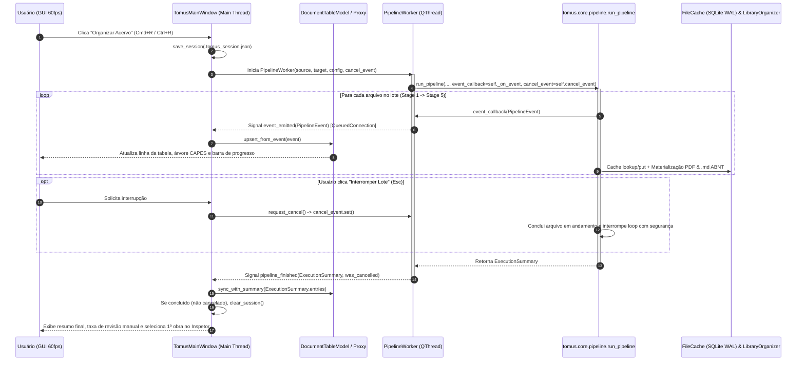

# Tomus Desktop GUI — Especificação de UX/UI e Arquitetura Multiplataforma (v1.0.0)

* **Autor:** Arquiteto de UX/UI & Engenheiro de Interface Desktop (Staff/Principal GUI Engineer)
* **Data:** 2026-11-06
* **Versão Alvo:** `1.0.0` (sobre o motor `tomus.core` `v0.4.0`)
* **Status:** Especificação Aprovada — Passagem 1 (Design System, Wireframes, Fluxos e Arquitetura Qt6/PySide6)
* **Plataformas Suportadas:** macOS (Apple Silicon & Intel — referência primária), Windows 10/11 e Linux (Wayland/X11 — GNOME/KDE)

---

## 1. Visão Geral e Manifesto Anti-AI-Slop

O **Tomus Desktop (`v1.0.0`)** é a interface gráfica oficial do organizador acadêmico de PDFs Tomus. Projetada sob o conceito **"Editorial Academic Workbench"** (Bancada Editorial Acadêmica), sua identidade visual e ergonômica inspira-se em ferramentas de precisão consagradas — **Zotero 7**, **Things 3**, **Linear** e **Panic Nova** — combinando a sobriedade tipográfica de um catálogo universitário com a densidade e velocidade de uma IDE técnica.

### 1.1. Regras de Ouro Anti-AI-Slop (Estritamente Proibido)

Para erradicar qualquer semelhança com templates genéricos de SaaS ou interfaces geradas por IA (*AI slop*), o pacote `tomus.gui` obedece a cinco restrições inegociáveis auditadas em código e folha de estilo (QSS):

1. **Zero Gradientes Neon / Roxo-Rosa ("AI Glow"):** São estritamente proibidos fundos, botões, bordas ou barras de progresso com gradientes `purple-to-pink`, `indigo-to-cyan` ou sombras difusas coloridas (`drop-shadow` neon). Toda cor de acento é sólida, opaca e ancorada em tons editoriais (Azul Oxford no claro, Azul Ardósia no escuro).
2. **Zero Emojis Crus na Interface:** É proibido usar caracteres emoji (`📂`, `🚀`, `✨`, `⚙️`, `✅`, `⚠️`, `📄`) em rótulos de botões, cabeçalhos de tabela, nós da árvore CAPES/CNPq ou barras de status. Todos os glifos visuais utilizam exclusivamente **ícones vetoriais SVG monocromáticos** com traço geométrico uniforme de `1.5px` (`stroke-linecap="round"`, `stroke-linejoin="round"`) renderizados via `QIcon` parametrizado pela cor de texto/acento do tema ativo.
3. **Zero Síndrome de Landing Page ("SaaS Hero"):** A janela do aplicativo abre diretamente na bancada de trabalho funcional. Não existem banners promocionais, frases de boas-vindas centralizadas com subtítulos em caixa-alta espaçada (*tracked-out ALL-CAPS eyebrows*) nem cartões gigantes com cantos hiper-arredondados (`border-radius > 8px`) flutuando sobre espaço vazio.
4. **Alta Densidade Informacional e Rigor Tabular:** Pesquisadores catalogam lotes de centenas de livros, artigos e teses com títulos extensos. As linhas da tabela de documentos possuem altura compacta (`28px` a `30px`), padding interno enxuto (`4px 8px`), truncamento inteligente com *tooltip* completo (`Qt.TextElideMode.ElideMiddle` para caminhos e `ElideRight` para títulos) e alinhamento numérico monoespaçado (`tabular-nums`).
5. **Zero Pílulas Decorativas Sem Função:** Badges e indicadores cromáticos são restritos aos cinco estados semânticos reais do pipeline (`Organizado`, `Revisão Manual`, `Duplicata`, `Ignorado Não-PDF`, `Erro`) e aos marcadores técnicos auditáveis (`Cache Hit`, `OCR`, `Dry-Run`).

---

## 2. Design System: "Editorial Academic Workbench"

### 2.1. Paletas de Cores Semânticas (Tokens Hexadecimais)

O sistema de temas (`src/tomus/gui/theme.py`) opera sobre dois dicionários imutáveis de tokens cromáticos (`ThemeTokens`), alternáveis em tempo real ou sincronizados com a aparência do sistema operacional (`QStyleHints.colorScheme()`):

| Token Semântico | Identificador (`ThemeTokens`) | Modo Claro: **Editorial Paper** | Modo Escuro: **Technical Graphite** | Aplicação nos Componentes Qt6 |
| :--- | :--- | :--- | :--- | :--- |
| **Superfície Base (Janela / Sidebar)** | `bg_canvas` | `#F6F5F1` *(Alabastro Papel)* | `#141517` *(Grafite Profundo)* | Fundo de `QMainWindow`, `SidebarTree`, `StatusBar` e `Toolbar`. |
| **Superfície Principal (Dados / Grade)** | `bg_surface` | `#FFFFFF` *(Papel Puro)* | `#1B1C1F` *(Ardósia Escura)* | Fundo da `DocumentTableView`, `InspectorPanel` e área de leitura ABNT. |
| **Superfície Elevada / Hover / Input** | `bg_elevated` | `#EFECE6` *(Pergaminho Sutil)* | `#232529` *(Grafite Elevado)* | Fundo de `QLineEdit`, `QComboBox`, linhas em hover e cabeçalhos de seção. |
| **Superfície de Seleção Ativa** | `bg_selected` | `#E4ECF5` *(Azul Papel Pálido)* | `#1E2D40` *(Azul Noturno Sutil)* | Linha selecionada na grade de documentos e item ativo na árvore lateral. |
| **Borda de Divisão (Hairline `1px`)** | `border_subtle` | `#E2DFD7` *(Linha Editorial)* | `#2E3036` *(Fio Técnico)* | Divisórias de `QSplitter` (`1px`), bordas de inputs, cabeçalhos e rodapé. |
| **Borda de Foco / Destaque** | `border_focus` | `#1E3A5F` *(Azul Oxford)* | `#4A7BB0` *(Azul Ardósia)* | Anel de foco (`1px solid`) em campos de texto e seletores ativos. |
| **Texto Primário (Tinta Principal)** | `text_primary` | `#18181B` *(Tinta Nanquim)* | `#F4F4F6` *(Giz Técnico)* | Títulos de obras, autores principais, valores de configuração e citação ABNT. |
| **Texto Secundário (Metadados)** | `text_secondary` | `#52525B` *(Cinza Chumbo)* | `#9CA3AF` *(Cinza Prata)* | Subtítulos, áreas básicas, rótulos de formulário e contadores secundários. |
| **Texto Silenciado (Placeholder / Hash)** | `text_muted` | `#71717A` *(Cinza Pedra)* | `#6B7280` *(Cinza Escuro)* | Hashes SHA-256 truncados, caminhos de origem desabilitados e timestamps. |
| **Acento Primário (Ação Principal)** | `accent_primary` | `#1E3A5F` *(Azul Oxford)* | `#4A7BB0` *(Azul Ardósia Luminoso)* | Botão primário (`Organizar Acervo`), barra de progresso ativa e links DOI. |
| **Acento Primário Hover** | `accent_hover` | `#162B47` *(Oxford Profundo)* | `#5B8EC4` *(Ardósia Claro)* | Estado `:hover` do botão de ação principal e controles ativos. |
| **Texto sobre Acento** | `text_on_accent` | `#FFFFFF` *(Branco)* | `#FFFFFF` *(Branco)* | Rótulo e ícone vetorial dentro do botão primário. |

#### Cores Semânticas de Status Documental (Sóbrias e de Alto Contraste)

| Estado (`ProcessStatus` / Badge) | Texto / Ícone (Claro) | Fundo Badge (Claro) | Texto / Ícone (Escuro) | Fundo Badge (Escuro) | Significado Operacional |
| :--- | :--- | :--- | :--- | :--- | :--- |
| **`ORGANIZED` (`Organizado`)** | `#15803D` *(Verde Botânico)* | `#DCFCE7` | `#4ADE80` | `#142E1F` | Classificado com confiança $\ge$ limiar e materializado na árvore CAPES. |
| **`MANUAL_REVIEW` (`Revisão Manual`)** | `#B45309` *(Âmbar Editorial)* | `#FEF3C7` | `#FBBF24` | `#33240B` | Confiança $<$ limiar ou título genérico; encaminhado para `revisao_manual/`. |
| **`DUPLICATE_SKIPPED` (`Duplicata`)** | `#0369A1` *(Azul Petróleo)* | `#E0F2FE` | `#38BDF8` | `#0F293A` | Mesmo `SHA-256` de obra canônica; isolado em `duplicatas/` com `.md`. |
| **`IGNORED_NON_PDF` (`Ignorado`)** | `#52525B` *(Cinza Neutro)* | `#EAE8E1` | `#9CA3AF` | `#27292E` | Extensão não-PDF (`.webloc`, `.epub`, `.docx`, etc.) auditada no relatório. |
| **`ERROR` (`Erro`)** | `#B91C1C` *(Carmim)* | `#FEE2E2` | `#F87171` | `#381515` | Assinatura `%PDF-` ausente, arquivo corrompido ou falha crítica de leitura. |

---

### 2.2. Tipografia Multiplataforma e Escala Modular

A tipografia utiliza uma pilha nativa por sistema operacional resolvida dinamicamente em `src/tomus/gui/theme.py`, garantindo renderização subpixel/antialiasing perfeita em telas Retina (macOS) e ClearType/FreeType (Windows/Linux):

* **Família Sans-Serif de Interface (`FONT_UI`):**
  * **macOS:** `"SF Pro Text", "Helvetica Neue", sans-serif`
  * **Windows:** `"Segoe UI Variable Text", "Segoe UI", sans-serif`
  * **Linux:** `"Inter", "Cantarell", "Noto Sans", sans-serif`
* **Família Monoespaçada Técnica (`FONT_MONO`):**
  * **macOS:** `"SF Mono", "JetBrains Mono", "Menlo", monospace`
  * **Windows:** `"Cascadia Mono", "Consolas", monospace`
  * **Linux:** `"JetBrains Mono", "DejaVu Sans Mono", monospace`
* **Família Editorial para Pré-visualização ABNT (`FONT_EDITORIAL`):**
  * Utiliza `FONT_UI` com suporte real a pesos variados (`400 Regular`, `600 SemiBold`, `700 Bold`) para renderizar fielmente a caixa-alta dos sobrenomes e o destaque tipográfico (**negrito**) do título exigido pela **ABNT NBR 6023**.

#### Escala Tipográfica e Geometria de Densidade

| Nível / Elemento | Fonte | Tamanho (`pt`/`px`) | Peso | Altura de Linha / Geometria | Regras Especiais |
| :--- | :--- | :--- | :--- | :--- | :--- |
| **Cabeçalho de Painel (`SectionHeader`)** | `FONT_UI` | `11px` | `600 SemiBold` | Altura fixa `28px` | Caixa-alta discreta (`letter-spacing: 0.4px`), cor `text_secondary`. |
| **Célula de Tabela (`DocumentTableView`)** | `FONT_UI` | `12.5px` | `400 Regular` (`500` no Título) | Altura de linha `28px` | Números com `font-variant-numeric: tabular-nums` (Ano, Confiança). |
| **Árvore Lateral (`SidebarTree`)** | `FONT_UI` | `12.5px` | `400 Regular` | Altura de item `26px` | Contador numérico alinhado à direita em pílula neutra (`11px`). |
| **Citação ABNT (`ABNTCardWidget`)** | `FONT_EDITORIAL` | `13px` | `400` / `700 Bold` | Entrelinha `1.45` | Fundo levemente destacado (`bg_elevated`), borda esquerda `3px solid accent_primary`. |
| **Metadados Técnicos (DOI, ISBN, SHA-256, Caminhos)** | `FONT_MONO` | `11.5px` | `400 Regular` | Entrelinha `1.35` | Seleção por clique duplo; truncamento elíptico no meio para hashes/paths. |
| **Logs e Gaveta de Diagnóstico** | `FONT_MONO` | `11px` | `400 Regular` | Altura de linha `18px` | Scroll vertical automático opcional (*follow tail*). |

---

### 2.3. Sistema de Ícones Vetoriais Embutidos (`icons.py`)

Nenhum arquivo externo `.png` ou emoji é utilizado. O módulo `src/tomus/gui/icons.py` contém um dicionário de **primitivas SVG vetoriais puras** (viewBox `0 0 24 24`, traço `1.5px`, sem preenchimento pesado) renderizadas em memória via `QSvgRenderer` + `QPainter` sobre `QPixmap` com `devicePixelRatio` nativo (suporte `@2x`/`@3x` Retina/High-DPI):

* `folder-input`: Pasta com seta de entrada (Origem).
* `folder-output`: Pasta com marcador de árvore (Destino).
* `play-run`: Triângulo geométrico técnico (Organizar Acervo).
* `stop-square`: Quadrado sólido interno (Interromper / Cancelar lote).
* `rotate-ccw`: Seta circular anti-horária (Retomar Sessão `.tomus_session.json`).
* `sliders-settings`: Três trilhos horizontais com seletores (Preferências e Chaves de API).
* `database-cache`: Cilindro técnico discreto (Inspeção/Limpeza do Cache SQLite).
* `check-circle`: Círculo com marca de verificação (Status: Organizado).
* `alert-triangle`: Triângulo com ponto de exclamação (Status: Revisão Manual / Teto > 20%).
* `copy-layers`: Dois retângulos sobrepostos (Status: Duplicata / Copiar Citação ABNT).
* `file-slash`: Folha com traço diagonal (Status: Ignorado Não-PDF).
* `x-octagon`: Octógono com X (Status: Erro).
* `external-link`: Caixa com seta diagonal superior direita (Abrir PDF no leitor do sistema).
* `folder-reveal`: Lupa sobre pasta (Mostrar no Finder / Explorer / Gerenciador de Arquivos).
* `scan-ocr`: Moldura de foco com linhas de texto internas (Indicador de OCR Docling utilizado).
* `cpu-provider`: Chip geométrico (Indicador do provedor LLM ativo / Fallback).

---

## 3. Arquitetura de Layout Desktop: Bancada de 3 Painéis + Barras Operacionais

A janela principal (`TomusMainWindow`, dimensões mínimas `1080x680`, padrão inicial `1360x840`) adota uma arquitetura de **Bancada Única (Single-Window Workbench)** sem abas ocultas para o fluxo principal. Toda a operação ocorre através de quatro zonas acopladas:

1. **Zona Superior — Barra de Comando e Operação (`OperationalToolbar` + `SessionResumeBanner` condicional)**
2. **Zona Central Esquerda — Navegador de Filtros e Árvore Taxonômica CAPES/CNPq (`CapesSidebarPanel`)**
3. **Zona Central (Miolo) — Grade de Documentos de Alta Densidade (`DocumentTablePanel`)**
4. **Zona Central Direita — Inspetor ABNT NBR 6023, Metadados e Triagem Manual (`DocumentInspectorPanel`)**
5. **Zona Inferior — Barra de Telemetria ao Vivo e Gaveta de Diagnóstico (`TelemetryStatusBar` + `LogCacheDrawer`)**

As três zonas centrais são gerenciadas por um `QSplitter(Qt.Orientation.Horizontal)` com proporções iniciais `240px : 1fr (flexível) : 360px`, divisórias de `1px` (`handleWidth(1)`) e colapso suave do painel direito via atalho (`Cmd+I` / `Ctrl+I`).

---

### 3.1. Wireframe Estrutural da Bancada Principal (ASCII Art)

```text
+----------------------------------------------------------------------------------------------------------------------------------------+
| Tomus                                                                                                            [_] [ ] [X]       |
+----------------------------------------------------------------------------------------------------------------------------------------+
| [ORIGEM]  ~/Downloads/Acervo_Bruto          [Procurar...]  |  [DESTINO] ~/Tomusa_CAPES          [Procurar...]                      |
| [PROVEDOR] [ Gemini (gemini-3.5-flash)  v ] (* Chave OK)   |  [MODO: Copiar | Mover] [x] Recursivo [ ] Dry-Run                         |
|                                                                             [Preferencias] [Cache]  [ |> Organizar Acervo (Cmd+R) ]    |
+----------------------------------------------------------------------------------------------------------------------------------------+
| (!) SESSAO INTERROMPIDA DETECTADA: ~/Downloads/Acervo_Bruto -> ~/Tomusa_CAPES (14/85 concluidos)  [Retomar Sessao] [Descartar]     |
+---------------------------+-----------------------------------------------------------------------+------------------------------------+
| FILTROS & TAXONOMIA       | DOCUMENTOS DO LOTE                              [Buscar titulo/autor] | INSPETOR DA OBRA          [Fechar] |
|---------------------------+-----------------------------------------------------------------------+------------------------------------|
| VISAO DE STATUS           | ST | TITULO DA OBRA             | AUTOR(ES)      | ANO  | AREA  | CONF| STATUS: [ORGANIZADO]  [OCR: Nao]   |
| * Todos os Itens    (120) |----+----------------------------+----------------+------+-------+-----+------------------------------------|
| o Organizados        (98) | OK | Principios Basicos de A... | Moreira; Med...| 2007 | Psico | 0.96| REFERENCIA ABNT NBR 6023           |
| ! Revisao Manual     (14) | OK | Redes Neurais Artificia... | Silva, Joao    | 2021 | C.Comp| 0.92| +--------------------------------+ |
| = Duplicatas          (5) | !! | scan_aula_04_final.pdf     | Autor Descon...| s.d. | Outros| 0.35| | MOREIRA, M. B.; MEDEIROS, C.   | |
| / Ignorados Nao-PDF   (2) | == | copia_moreira_2007.pdf     | Moreira; Med...| 2007 | Psico | 1.00| | A. **Principios Basicos de     | |
| x Erros               (1) | // | link_artigo_scielo.webloc  | —              | —    | —     | —   | | Analise do Comportamento**.    | |
|                           | XX | pdf_truncado_corrompido.pdf| —              | —    | —     | 0.00| | 2007. ISBN 978-85-363-0912-5.  | |
| ARVORE CAPES/CNPq         | OK | Fenomenologia da Percep... | Merleau-Ponty  | 1999 | Filos | 0.89| +--------------------------------+ |
| v Ciencias Humanas   (42) | OK | Metodologia do Trabalho... | Severino, A. J.| 2016 | Educ  | 0.94| [ Copiar Citacao ABNT ] [Copiar MD]|
|     Psicologia       (18) | !! | doc_digitalizado_antigo.pdf| —              | 1984 | Hist  | 0.58|                                    |
|     Educacao         (15) |                                                                       | CLASSIFICACAO CAPES/CNPq           |
|     Filosofia         (9) |                                                                       | Grande Area: Ciencias Humanas      |
| v Ciencias Exatas    (31) |                                                                       | Area Basica: Psicologia            |
|     Ciencia da Comp. (24) |                                                                       | Tipo:        Livro                 |
|     Matematica        (7) |                                                                       | Confianca:   96% (gemini-3.5-flash)|
| > Ciencias Sociais   (19) |                                                                       |                                    |
| > Engenharias         (6) |                                                                       | METADADOS & AUDITORIA              |
|                           |                                                                       | DOI:     —                         |
|                           |                                                                       | ISBN:    9788536309125             |
|                           |                                                                       | SHA-256: 8f4b2e9c...a17d04e2 [Cop] |
|                           |                                                                       | Origem:  .../Acervo/moreira07.pdf  |
|                           |                                                                       | Destino: .../Psicologia/Livro/...  |
|                           |                                                                       |                                    |
|                           |                                                                       | JUSTIFICATIVA LLM (REASONING)      |
|                           |                                                                       | Obra classica de Psicologia Expe-  |
|                           |                                                                       | rimental / Analise do Comportamen- |
|                           |                                                                       | to confirmada via ISBN e ficha CIP.|
|                           |                                                                       |                                    |
|                           |                                                                       | [ Abrir PDF ] [ Mostrar na Pasta ] |
+---------------------------+-----------------------------------------------------------------------+------------------------------------+
| [=================>        ] 82% (98/120) | Restam: 22 | Estagio: Stage 4 (LLM: gemini-3.5-flash) | Taxa Revisao: 11.6% (OK) | [Logs ^]|
+----------------------------------------------------------------------------------------------------------------------------------------+
```

---

### 3.2. Detalhamento dos Componentes dos 3 Painéis e Barras

#### A. Barra Superior de Operação (`OperationalToolbar`)
* **Seletores de Diretório (`SourcePathField` & `TargetPathField`):**
  * Campos `QLineEdit` somente-leitura estilizados com fonte monoespaçada compacta, acompanhados de botão `Procurar...` (`QFileDialog.getExistingDirectory`).
  * **Drag & Drop Nativo:** Tanto os campos individuais quanto a janela inteira aceitam o arraste de pastas diretamente do Finder (macOS), File Explorer (Windows) ou Nautilus/Dolphin (Linux). Soltar uma pasta sobre o seletor de origem preenche `source_dir` e executa imediatamente uma pré-contagem rápida não-bloqueante de candidatos.
  * **Validação Preventiva Imediata:** Se o usuário selecionar `SOURCE_DIR == TARGET_DIR`, a borda do campo de destino muda para `Erro` (`#B91C1C`) e o botão `Organizar Acervo` é desabilitado com explicação clara no rodapé, espelhando a regra do Stage 1 (`scanner.py`).
* **Seletor de Provedor e Status da Cadeia (`ProviderSelectorWidget`):**
  * `QComboBox` listando os 6 provedores oficiais suportados pelo motor (`gemini`, `groq`, `nvidia`, `deepseek`, `claude`, `github`) com o nome do modelo efetivo resolvido a partir de `AppConfig`.
  * Ao lado do combo, um indicador luminoso discreto (`6px` de diâmetro) + texto curto informa a prontidão das credenciais:
    * `Chave Ativa (+2 Fallbacks)`: Provedor primário autenticado e cadeia de fallback (`FallbackLLMDispatcher`) pronta.
    * `Sem Chave (Modo Simulado/Mock)`: Alerta em âmbar com link direto de 1 clique para abrir o modal de **Preferências e Chaves de API**.
* **Controles de Modo Operacional:**
  * **Segmented Control `Copiar | Mover`:** Dois botões agrupados mutuamente exclusivos (`file_operation = "copy"` por padrão seguro; ao alternar para `"move"`, exibe um *tooltip* de aviso informando que os originais serão removidos após cópia verificada).
  * **Checkboxes Técnicos:** `Recursivo` (`recursive = True` por padrão) e `Simulação (Dry-Run)` (`dry_run = False` por padrão; quando ativo, exibe um badge discreto `[DRY-RUN]` ao lado do botão principal).
* **Botão de Ação Primária Contextual:**
  * Estado Ocioso: **`Organizar Acervo`** (fundo `accent_primary`, atalho `Cmd+R` / `Ctrl+R`).
  * Estado Executando: Transforma-se em **`Interromper Lote`** (fundo sóbrio carmim `#B91C1C`, atalho `Esc` ou `Cmd+.`), que aciona `cancel_event.set()` e altera seu rótulo para `Finalizando estágio atual...` até que a worker thread encerre com segurança.
* **Banner Condicional de Retomada de Sessão (`SessionResumeBanner`):**
  * No startup da GUI, consulta `load_session()` (`tomus.core.session`). Se `.tomus_session.json` existir e for válido, exibe uma faixa fina (`34px` de altura) abaixo da toolbar com os detalhes da sessão interrompida (`source_dir`, `target_dir`, `provider`, `created_at`) e dois botões: **`Retomar Sessão`** (restaura todos os parâmetros e inicia o pipeline aproveitando o cache SQLite por SHA-256) e **`Descartar`** (chama `clear_session()`).

#### B. Painel Esquerdo — Filtros de Status e Árvore CAPES/CNPq (`CapesSidebarPanel`)
* **Seção 1 — Visão de Status Operacional:**
  * Lista fixa com 6 filtros rápidos acompanhados de contadores em tempo real (`tabular-nums`):
    1. `Todos os Itens`
    2. `Organizados` (`ProcessStatus.ORGANIZED`)
    3. `Revisão Manual` (`ProcessStatus.MANUAL_REVIEW`)
    4. `Duplicatas` (`ProcessStatus.DUPLICATE_SKIPPED`)
    5. `Ignorados (Não-PDF)` (`ProcessStatus.IGNORED_NON_PDF`)
    6. `Erros` (`ProcessStatus.ERROR`)
* **Seção 2 — Árvore Taxonômica CAPES/CNPq Dinâmica:**
  * `QTreeWidget` / `QTreeView` populado dinamicamente com as **Grandes Áreas**, **Áreas Básicas** e **Tipos Documentais** (`Livro`, `Revista Científica`, `Artigo`, `Tese_Dissertacao`, `Outros`) presentes no lote atual (ou carregados de um `manifest.json` existente na pasta de destino).
  * Clicar em qualquer nó (`Ciências Humanas` $\rightarrow$ `Psicologia` $\rightarrow$ `Livro`) filtra instantaneamente a grade central via `DocumentFilterProxyModel` sem tocar no disco.

#### C. Painel Central — Grade de Documentos de Alta Densidade (`DocumentTablePanel`)
* Implementado sobre `QTableView` acoplado a um `QAbstractTableModel` customizado (`DocumentTableModel`) e um `QSortFilterProxyModel` (`DocumentFilterProxyModel`), garantindo performance de **60fps** mesmo com lotes de **5.000+ arquivos PDF**.
* **Barra de Filtro Textual Instantâneo:** Acima da grade, um campo compacto `Filtrar por título, autor, ano, DOI, ISBN ou nome original...` (`Cmd+F` / `Ctrl+F`) filtra as linhas em tempo real com *debounce* de `120ms`.
* **Colunas da Grade:**
  1. **`Status` (`96px`):** Badge semântico compacto com ícone vetorial + rótulo curto (`Organizado`, `Revisão`, `Duplicata`, `Ignorado`, `Erro`, ou `Processando...` com indicador de estágio quando em andamento).
  2. **`Título / Arquivo` (`flex`, mín. `260px`):** Exibe o título acadêmico normalizado em peso `500` (ou o nome do arquivo original `source_path.name` enquanto não classificado / quando em revisão manual), com subtítulo em `text_secondary` na mesma célula ou ao passar o mouse.
  3. **`Autor(es)` (`180px`):** Autores formatados (`Sobrenome, Nome` ou `Sobrenome1; Sobrenome2` / `et al.`).
  4. **`Ano` (`56px`, alinhado à direita, `tabular-nums`):** Ano de publicação ou `s.d.`.
  5. **`Grande Área / Área Básica` (`210px`):** Par validado da tabela CAPES/CNPq (ex.: `Ciências Humanas › Psicologia`).
  6. **`Tipo` (`110px`):** `Livro`, `Revista Científica`, `Artigo`, `Tese_Dissertacao` ou `Outros`.
  7. **`Confiança` (`72px`, alinhado à direita, `tabular-nums`):** Percentual ou decimal (`0.96` / `96%`) com barra horizontal sutil de `3px` na base da célula colorida conforme o limiar `confidence_min`.
  8. **`Flags` (`64px`, centralizado):** Badges técnicos discretos `OCR` (quando `used_ocr == True`) e `CACHE` (quando servido por `FileCache`).

#### D. Painel Direito — Inspetor ABNT NBR 6023 & Triagem de Revisão Manual (`DocumentInspectorPanel`)
O Inspetor adapta sua visualização automaticamente conforme o `ProcessStatus` do documento selecionado na grade:

1. **Modo 1: Obra Organizada (`ProcessStatus.ORGANIZED`)**
   * **Cartão de Referência ABNT NBR 6023 (`ABNTReferenceCard`):**
     * Renderiza em tempo real a referência bibliográfica gerada por `tomus.storage.companion.format_abnt_reference(classification)` com formatação rica (sobrenomes dos autores em CAIXA ALTA, título em **negrito**, subtítulo, ano, link DOI e ISBN).
     * Dois botões de utilidade imediata para o pesquisador:
       * **`Copiar Citação ABNT`** (`Cmd+Shift+C` / `Ctrl+Shift+C`): Copia a referência limpa para a área de transferência (`QApplication.clipboard()`) e muda temporariamente o rótulo do botão para `Copiado!` por `1.5s`.
       * **`Copiar Ficha Markdown (.md)`**: Copia o conteúdo integral do arquivo companheiro `.md` (Front Matter YAML + Citação ABNT + Metadados) gerado por `generate_companion_markdown`.
   * **Ficha de Classificação CAPES/CNPq:** Exibe `Grande Área`, `Área Básica`, `Tipo Documental`, `Score de Confiança` e o par `provider_name / model_name` efetivo que classificou a obra.
   * **Metadados & Identificadores Verificados:** Exibe `DOI` (clicável para abrir `https://doi.org/<doi>`), `ISBN`, `SHA-256` (com botão de cópia rápida), `Caminho de Origem`, `Caminho de Destino` (nome padronizado até 240 bytes UTF-8) e flag `OCR Seletivo (Docling)`.
   * **Justificativa do Modelo (`reasoning`):** Bloco de leitura limpa exibindo o argumento semântico retornado pelo LLM ou pela trava determinística.
   * **Ações de Sistema de Arquivos:** Botões **`Abrir PDF`** e **`Mostrar na Pasta`** (apontando para o destino organizado, ou para a origem quando em modo `dry_run`).

2. **Modo 2: Triagem Rápida de Revisão Manual / Erro (`MANUAL_REVIEW` ou `ERROR`)**
   * Exibe em destaque no topo um **Quadro de Diagnóstico de Pendência** (borda `Âmbar Editorial` ou `Carmim`) contendo:
     * **Motivo Exato do Encaminhamento (`error_message` / `reasoning`):** Ex.: *"Confiança 0.45 abaixo do limiar (0.70)"*, *"Título genérico sem autor identificável (trava 0.50)"*, ou *"Assinatura %PDF- ausente ou arquivo corrompido"*.
   * **Assistente de Triagem Manual Assistida (`ManualTriageBox`):**
     * Permite ao usuário inspecionar o PDF original clicando em **`Abrir PDF para Inspeção`** e, caso deseje aprovar/classificar manualmente o item diretamente pela GUI sem precisar mover pastas à mão:
       * Seletores acoplados ao catálogo oficial `taxonomy.py`: `ComboBox Grande Área` (`get_grandes_areas()`) $\rightarrow$ `ComboBox Área Básica` (`get_areas_basicas(grande_area)`) $\rightarrow$ `ComboBox Tipo` (`DocumentType`).
       * Campos editáveis preenchidos com a sugestão parcial do LLM (se houver): `Título`, `Subtítulo`, `Autor(es)` (separados por `;`) e `Ano`.
       * Pré-visualização ao vivo do novo nome padronizado (`format_academic_filename`) e da citação ABNT resultante.
       * Botão **`Aprovar e Materializar na Tomusa`**: Executa a movimentação/cópia de `revisao_manual/` para a pasta temática `<Grande Área>/<Área Básica>/<Tipo>/`, gera o `.md` companheiro ABNT, grava a classificação revisada no `FileCache` SQLite (`confidence_score = 1.0`, `model_name = "manual_human_review"`) e atualiza `manifest.json` e `relatorio_revisao.md`.

3. **Modo 3: Duplicata Exata (`DUPLICATE_SKIPPED`) ou Não-PDF Ignorado (`IGNORED_NON_PDF`)**
   * Para **Duplicatas**: Exibe o hash `SHA-256` idêntico, o caminho da duplicata isolada em `<TARGET_DIR>/duplicatas/` e um link direto (`Selecionar Obra Canônica` / `Mostrar Obra Canônica na Pasta`) apontando para o PDF principal já organizado na árvore temática.
   * Para **Não-PDFs Ignorados**: Exibe o diagnóstico tipado do `LibraryOrganizer.add_ignored_non_pdf` (ex.: *"Atalho de internet macOS (.webloc)"*, *"E-book não-PDF (.epub)"*) e botão para revelar o arquivo original no sistema.

#### E. Barra Inferior de Telemetria ao Vivo e Gaveta de Diagnóstico (`TelemetryStatusBar` & `LogCacheDrawer`)
* **Barra de Progresso Determinística:** Alimentada diretamente pelos campos `completed_files` e `total_files` de `PipelineEvent`. Exibe porcentagem exata, fração (`98 / 120 concluídos`) e contador regressivo (`Restam: 22`).
* **Indicador de Estágio em Tempo Real:** Traduz o campo `stage` do `PipelineEvent` (`scanner` $\rightarrow$ `cache` $\rightarrow$ `extractor` $\rightarrow$ `enricher` $\rightarrow$ `llm` $\rightarrow$ `organizer`) em uma trilha visual concisa indicando qual arquivo está sendo processado no momento.
* **Monitor do Teto de Revisão Manual (Meta de Qualidade $\le 20\%$):**
  * Calcula continuamente `manual_review_ratio`. Enquanto $\le 20\%$, exibe badge neutro/verde `Revisão Manual: 11.6% (Dentro da meta <= 20%)`.
  * Se ultrapassar `20%` (`exceeded_manual_review_ceiling == True`), o indicador muda para `Âmbar Editorial` (`! Revisão Manual: 23.4% — Acima do teto de 20%`), clicável para filtrar imediatamente os itens de revisão manual.
* **Gaveta Expansível (`LogCacheDrawer` — atalho `` Cmd+` `` / `` Ctrl+` ``):**
  * Painel inferior colapsável (`180px` de altura quando aberto) dividido em duas abas técnicas enxutas:
    1. **`Log de Execução (tomus.log)`:** Visualizador monoespaçado em tempo real anexado ao logger do `tomus.core.logging`.
    2. **`Estado do Cache SQLite (state.db)`:** Exibe o caminho `~/.cache/tomus/state.db`, tamanho em KB/MB, total de obras indexadas (`SELECT COUNT(*) FROM processed_files`) e botão **`Limpar Cache SQLite`** (com confirmação segura que invoca `FileCache.clear()`).

---

### 3.3. Wireframe do Modal de Preferências e Chaves de API (`PreferencesDialog`)

Acessível pelo botão `Preferências` na toolbar ou pelo atalho padrão do sistema (`Cmd+,` no macOS / `Ctrl+,` no Windows e Linux), este diálogo modal lê e grava `~/.config/tomus/config.toml` (ou `./tomus.toml` local) preservando permissões restritas `0600` (`CONFIG_FILE_MODE`):

```text
+--------------------------------------------------------------------------------------------------+
| Preferencias e Credenciais — Tomus                                                    [Fechar]|
+--------------------------------------------------------------------------------------------------+
| [ Provedores LLM & Fallback ]  [ Credenciais e Chaves de API ]  [ Pipeline, OCR & Cache ]        |
+--------------------------------------------------------------------------------------------------+
| ARQUIVO DE CONFIGURACAO ATIVO: ~/.config/tomus/config.toml (Permissao 0600 Segura)           |
|--------------------------------------------------------------------------------------------------|
| CREDENCIAIS DOS PROVEDORES DE CLASSIFICACAO (Stage 4)                                            |
|                                                                                                  |
| Google Gemini API Key:      [ ****a9F2                                  ] [Mostrar] (Via TOML)   |
| Groq Cloud API Key:         [ ****7xQp                                  ] [Mostrar] (Via ENV)    |
| NVIDIA NIM API Key:         [                                           ] [Mostrar] (Nao config) |
| DeepSeek API Key:           [ ****3mKz                                  ] [Mostrar] (Via TOML)   |
| Anthropic Claude API Key:   [                                           ] [Mostrar] (Nao config) |
| GitHub Models Token:        [                                           ] [Mostrar] (Nao config) |
|                                                                                                  |
| SERVICOS DE ENRIQUECIMENTO ACADEMICO (Stage 3 — OpenAlex & Google Books)                         |
|                                                                                                  |
| OpenAlex Polite Email:      [ pesquisador@universidade.edu.br           ] (Pool Rapido 10 req/s) |
| Google Books API Key:       [ ****9bLw                                  ] [Mostrar] (Via TOML)   |
|                                                                                                  |
| CADEIA DE FALLBACK AUTOMATICO (FallbackLLMDispatcher)                                            |
| Provedor Primario: [ gemini          v ]   Modelo Padrao: [ gemini-3.5-flash                   ] |
| Ordem de Fallback: [x] groq (openai/gpt-oss-20b) -> [x] nvidia -> [x] deepseek                   |
|                                                                                                  |
| LIMIAR DE QUALIDADE E CONCORRENCIA (Stage 1 a Stage 5)                                           |
| Confianca Minima (confidence_min): [ 0.70 ] (70%)    Workers de Rede: [ 1 ] (Sequencial Seguro)  |
|--------------------------------------------------------------------------------------------------|
| [ Restaurar Padroes ]                                      [ Cancelar ]  [ Salvar Configuracao ] |
+--------------------------------------------------------------------------------------------------+
```

**Regras de Segurança e Precedência no `PreferencesDialog`:**
1. **Respeito à Precedência `ENV > Local TOML > Global TOML`:** Para cada chave em `ApiKeysConfig`, o modal verifica se o valor ativo provém de uma variável de ambiente (ex.: `TOMUS_GEMINI_API_KEY` ou `GEMINI_API_KEY`). Quando uma variável de ambiente está ativa, o modal exibe um badge informativo `(Ativo via Variável de Ambiente)` ao lado do campo.
2. **Gravação Limpa (`tomli_w`) com Permissão `0600`:** Ao clicar em `Salvar Configuração`, a GUI serializa as seções `[general]`, `[llm]` e `[api_keys]` em `~/.config/tomus/config.toml` e aplica `os.chmod(path, 0o600)` em sistemas POSIX (macOS/Linux), garantindo que strings vazias continuem sendo filtradas por `FilteredTomlSettingsSource`.

---

## 4. Fluxos de Interação de Ponta a Ponta

### 4.1. Fluxo 1: Seleção, Pré-Inspeção e Execução de Lote com Telemetria ao Vivo
1. **Entrada Rápida:** O usuário arrasta uma pasta `~/Downloads/Artigos_Semestre` para a janela (ou seleciona via diálogo nativo) e define `~/Documentos/Tomusa_Acadêmica` como destino.
2. **Início e Persistência de Sessão:** Ao clicar em **`Organizar Acervo`** (`Cmd+R` / `Ctrl+R`):
   * A GUI salva imediatamente o estado em `.tomus_session.json` via `save_session(SessionState(...))` (espelhando o comportamento da CLI para garantir recuperação em caso de queda de energia).
   * A grade central é limpa e entra em modo de recepção de eventos em tempo real.
3. **Streaming de Eventos (`PipelineEvent` $\rightarrow$ Qt Signals):**
   * No `Stage 1 (scanner)`, assim que `scan_directory` conclui a triagem rápida, todas as entradas identificadas (PDFs válidos e não-PDFs ignorados) aparecem na grade com status inicial `Na Fila` (e `Ignorado` para não-PDFs), permitindo ao usuário visualizar imediatamente o tamanho real do lote.
   * À medida que cada PDF avança pelos estágios (`cache` $\rightarrow$ `extractor` $\rightarrow$ `enricher` $\rightarrow$ `llm` $\rightarrow$ `organizer`), a linha correspondente na grade atualiza seu estágio ao vivo (`Extraindo / OCR...`, `Consultando OpenAlex...`, `Classificando LLM...`) e, ao receber o evento terminal do arquivo, preenche instantaneamente `Título`, `Autor(es)`, `Ano`, `Grande Área / Área Básica`, `Tipo` e `Confiança`, incrementando os contadores da barra lateral CAPES/CNPq e a barra de progresso inferior.
4. **Conclusão do Lote:**
   * Quando `run_pipeline` retorna `ExecutionSummary`, a GUI reconcilia a tabela com `summary.entries`, remove `.tomus_session.json` via `clear_session()` (caso concluído sem cancelamento) e seleciona automaticamente o primeiro item organizado para exibir sua citação ABNT no Inspetor.

### 4.2. Fluxo 2: Cancelamento Cooperativo Seguro (`cancel_event`)
1. Durante o processamento de um lote longo (ex.: PDFs escaneados acionando Docling OCR ou múltiplas chamadas de rede), o usuário clica em **`Interromper Lote`** (ou pressiona `Esc`).
2. A thread de UI chama `self._worker.request_cancel()`, que executa `self._cancel_event.set()`.
3. A UI **não mata a thread à força** (`QThread.terminate()` é proibido pois corromperia o lock do SQLite WAL ou deixaria cópias de arquivos truncadas). Em vez disso, o botão exibe `Aguardando conclusão segura do arquivo atual...`.
4. O `run_pipeline` detecta `cancel_event.is_set()` na fronteira do arquivo atual, grava o `manifest.json` e `relatorio_revisao.md` parciais, preserva `.tomus_session.json` em disco para retomada futura e emite o sinal `finished(summary, was_cancelled=True)`.
5. A GUI exibe o banner de sessão pausada permitindo retomar exatamente de onde parou com 1 clique (os arquivos já aprovados serão resolvidos em milissegundos via `Cache Hit` no SQLite).

### 4.3. Fluxo 3: Auditoria Pós-Execução e Triagem de `revisao_manual/`
1. Ao final da execução (ou ao abrir uma pasta de destino que já contenha `manifest.json`), o usuário clica no filtro **`Revisão Manual (N)`** na barra lateral esquerda.
2. A grade exibe apenas os documentos que ficaram abaixo de `confidence_min` (ou tiveram falha de extração).
3. O usuário seleciona um PDF na grade, clica em **`Abrir PDF`** no Inspetor direito (ou pressiona `Barra de Espaço` na linha da tabela) para visualizar a capa do documento no leitor nativo do SO (`Preview.app` no macOS, `Edge/Acrobat` no Windows, `Evince/Okular` no Linux).
4. No quadro **Triagem Manual Assistida** do Inspetor, o usuário escolhe a `Grande Área` e a `Área Básica` oficiais da CAPES/CNPq, ajusta `Título`, `Autor` e `Ano` (vendo a referência ABNT NBR 6023 ser formatada em tempo real logo acima) e clica em **`Aprovar e Materializar na Tomusa`**.
5. O item muda seu status para `Organizado`, é movido de `revisao_manual/` para a pasta temática correta acompanhado de seu `.md` companheiro ABNT, e a `Taxa de Revisão Manual` na barra inferior cai imediatamente.

---

## 5. Arquitetura de Engenharia Desktop Multiplataforma (`PySide6` / `Qt6 Fusion`)

### 5.1. Justificativa Tecnológica: Por que `PySide6` + Motor `Fusion` + QSS Tokenizado?

Para atender simultaneamente ao rigor estético (**Editorial Academic Workbench**) e à portabilidade irrestrita (**macOS, Windows e Linux**), a camada gráfica é construída sobre **PySide6 (Qt 6)** com o motor de estilo **`Fusion`** (`QApplication.setStyle("Fusion")`) combinado a uma folha de estilos QSS gerada a partir de tokens Python (`ThemeTokens`):

1. **Identidade Visual Idêntica nos 3 Sistemas Operacionais:** Estilos nativos padrão do Qt (`macOS style`, `windowsvista`) frequentemente ignoram cores de fundo de botões, desenham bordas chanfradas legadas do Windows 7/95 ou quebram a densidade de tabelas no Linux GTK/KDE. O motor `Fusion` do Qt 6 fornece uma base vetorial limpa, determinística e acelerada por hardware que respeita 100% das propriedades QSS (`border: 1px solid`, `border-radius: 4px`, paddings exatos e cores hexadecimais das paletas *Editorial Paper* e *Technical Graphite*).
2. **Virtualização Nativa de Tabelas (`QTableView` + `QAbstractTableModel`):** Ao contrário de frameworks baseados em DOM/Webview (Electron/Tauri) ou kits simples (Tkinter/CustomTkinter) que travam ao instanciar centenas de widgets de linha, a arquitetura Model/View do Qt 6 renderiza apenas as células visíveis no *viewport*, mantendo rolagem a 60fps com consumo mínimo de RAM.
3. **Arquitetura de Sinais e Slots Thread-Safe (`QObject` / `Signal`):** A comunicação entre o `run_pipeline` (executando em background) e a thread principal da GUI ocorre por filas de eventos nativas do Qt (`Qt.ConnectionType.QueuedConnection`), eliminando condições de corrida (*race conditions*) ou travamentos da janela principal.

---

### 5.2. Estrutura Modular do Pacote `src/tomus/gui/`

```text
src/tomus/gui/
├── __init__.py              # Exporta launch_gui() e main()
├── app.py                   # Ponto de entrada (QApplication, High-DPI, Fusion style, CLI hook)
├── theme.py                 # ThemeTokens (Editorial Paper & Technical Graphite) + gerador QSS
├── icons.py                 # Renderizador SVG vetorial em memória (zero emojis, suporte Retina @2x)
├── os_integration.py        # Abstração multiplataforma (open_file, reveal_in_file_manager, paths)
├── worker.py                # PipelineWorker (QThread) + ManualTriageService + CacheStatsService
├── models.py                # DocumentTableModel (QAbstractTableModel) + DocumentFilterProxyModel
├── main_window.py           # TomusMainWindow (Workbench de 3 painéis, menus, atalhos, drag&drop)
└── widgets/
    ├── __init__.py
    ├── toolbar.py           # OperationalToolbar + SessionResumeBanner
    ├── sidebar.py           # CapesSidebarPanel (Filtros de status + Árvore CAPES/CNPq)
    ├── document_table.py    # DocumentTablePanel (Barra de busca + QTableView + StatusBadgeDelegate)
    ├── inspector.py         # DocumentInspectorPanel (ABNTReferenceCard + Metadados + ManualTriageBox)
    ├── status_drawer.py     # TelemetryStatusBar + LogCacheDrawer (Logs ao vivo + Cache SQLite)
    └── preferences_dialog.py# PreferencesDialog (Editor seguro de config.toml 0600 e API Keys)
```

---

### 5.3. Diagrama de Arquitetura e Concorrência (Thread de UI vs. Worker Thread)



---

### 5.4. Contratos Técnicos dos Módulos da GUI

#### 1. `src/tomus/gui/worker.py` — Execução Assíncrona e Cancelamento Cooperativo
```python
class PipelineWorker(QThread):
    """Executa run_pipeline em background sem bloquear a Event Loop do Qt."""

    event_received = Signal(object)          # Emite PipelineEvent
    pipeline_finished = Signal(object, bool) # Emite (ExecutionSummary, was_cancelled)
    pipeline_failed = Signal(str)            # Emite mensagem de erro inesperado

    def __init__(
        self,
        source_dir: Path,
        target_dir: Path,
        config: AppConfig,
        *,
        dry_run: bool = False,
        use_cache: bool = True,
        workers: int = 1,
        parent: QObject | None = None,
    ) -> None:
        super().__init__(parent)
        self.source_dir = source_dir
        self.target_dir = target_dir
        self.config = config
        self.dry_run = dry_run
        self.use_cache = use_cache
        self.workers = workers
        self.cancel_event = threading.Event()

    def request_cancel(self) -> None:
        """Aciona cancelamento cooperativo seguro no orquestrador."""
        self.cancel_event.set()

    def run(self) -> None:
        try:
            summary = run_pipeline(
                source_dir=self.source_dir,
                target_dir=self.target_dir,
                config=self.config,
                workers=self.workers,
                event_callback=self._handle_pipeline_event,
                use_cache=self.use_cache,
                dry_run=self.dry_run,
                cancel_event=self.cancel_event,
            )
            self.pipeline_finished.emit(summary, self.cancel_event.is_set())
        except Exception as exc:
            self.pipeline_failed.emit(str(exc))

    def _handle_pipeline_event(self, event: PipelineEvent) -> None:
        self.event_received.emit(event)
```

#### 2. `src/tomus/gui/os_integration.py` — Portabilidade macOS, Windows e Linux
Encapsula todas as interações dependentes de sistema operacional usando `sys.platform` e `pathlib.Path`, sem jamais concatenar strings com `/` manualmente:

| Operação | macOS (`darwin`) | Windows (`win32`) | Linux (`linux`) |
| :--- | :--- | :--- | :--- |
| **Abrir PDF / Markdown no aplicativo padrão (`open_file_in_os`)** | `subprocess.Popen(["open", str(path.resolve())])` | `os.startfile(str(path.resolve()))` | `subprocess.Popen(["xdg-open", str(path.resolve())])` |
| **Revelar arquivo selecionando-o na pasta (`reveal_in_file_manager`)** | `subprocess.Popen(["open", "-R", str(path.resolve())])` | `subprocess.Popen(["explorer", f"/select,{path.resolve()}"])` | `subprocess.Popen(["xdg-open", str(path.resolve().parent)])` |
| **Permissão de `config.toml` (`secure_chmod_600`)** | `os.chmod(path, 0o600)` | Ignorado com segurança se ACL POSIX não aplicável (`try/except OSError`) | `os.chmod(path, 0o600)` |

#### 3. Mapa de Atalhos de Teclado Multiplataforma (`QKeySequence`)
Todos os atalhos utilizam `QKeySequence` para mapear automaticamente `Cmd` (`⌘`) no macOS e `Ctrl` no Windows/Linux:

| Ação na Bancada | macOS | Windows / Linux |
| :--- | :--- | :--- |
| **Selecionar Pasta de Origem** | `Cmd+O` | `Ctrl+O` |
| **Selecionar Pasta de Destino** | `Cmd+Shift+O` | `Ctrl+Shift+O` |
| **Iniciar Organização do Acervo** | `Cmd+R` | `Ctrl+R` |
| **Interromper Lote em Execução** | `Esc` ou `Cmd+.` | `Esc` ou `Ctrl+.` |
| **Focar Busca / Filtro na Grade** | `Cmd+F` | `Ctrl+F` |
| **Copiar Citação ABNT NBR 6023 Selecionada** | `Cmd+Shift+C` | `Ctrl+Shift+C` |
| **Abrir PDF Selecionado no Leitor do Sistema** | `Espaço` ou `Cmd+Down` | `Espaço` ou `Ctrl+Return` |
| **Revelar Arquivo no Finder / Explorer / Nautilus** | `Cmd+Shift+R` | `Ctrl+Shift+R` |
| **Alternar Inspetor Direito (Mostrar/Ocultar)** | `Cmd+I` | `Ctrl+I` |
| **Alternar Gaveta de Logs & Cache SQLite** | `` Cmd+` `` | `` Ctrl+` `` |
| **Alternar Tema (Editorial Paper / Technical Graphite)** | `Cmd+Shift+T` | `Ctrl+Shift+T` |
| **Abrir Preferências e Chaves de API** | `Cmd+,` | `Ctrl+,` |

---

### 5.5. Pontos de Entrada (`pyproject.toml` e `tomus gui`)

A interface gráfica integra-se ao ecossistema de linha de comando sem quebrar a execução headless do motor (caso `PySide6` seja importado apenas quando a GUI for invocada):

1. **Subcomando na CLI (`src/tomus/cli/main.py`):**
   * `tomus gui [--source <PATH>] [--target <PATH>] [--dark | --light]`: Abre a bancada desktop pré-populando opcionalmente os diretórios de origem e destino passados via terminal.
2. **Script GUI Dedicado (`pyproject.toml`):**
   * Adição de `pyside6>=6.7.0` às dependências do projeto e registro de:
     ```toml
     [project.gui-scripts]
     tomus-gui = "tomus.gui.app:main"
     ```

---

## 6. Checklist de Auditoria para a Passagem 2 (Implementação e Testes)

Antes de concluir a Passagem 2, a implementação de `src/tomus/gui/` será validada contra os seguintes critérios objetivos:

- [ ] **Auditoria Anti-AI-Slop:** Verificação automatizada (`grep`/teste unitário) garantindo zero ocorrências de emojis Unicode nos módulos `src/tomus/gui/*.py` e zero gradientes lineares/radiais roxo/rosa no QSS.
- [ ] **Fidelidade das Paletas:** Testes unitários verificando todos os códigos hexadecimais de `EDITORIAL_PAPER_THEME` (`#F6F5F1`, `#FFFFFF`, `#EFECE6`, `#E2DFD7`, `#18181B`, `#52525B`, `#1E3A5F`) e `TECHNICAL_GRAPHITE_THEME` (`#141517`, `#1B1C1F`, `#232529`, `#2E3036`, `#F4F4F6`, `#9CA3AF`, `#4A7BB0`).
- [ ] **Integração com `tomus.core`:** Testes com `pytest` (em modo `QT_QPA_PLATFORM=offscreen` para rodar em qualquer ambiente CI/CD ou terminal sem abrir janelas bloqueantes) validando:
  - Fluxo completo do `PipelineWorker` emitindo `PipelineEvent` e populando o `DocumentTableModel`;
  - Cancelamento cooperativo via `cancel_event`;
  - Renderização e cópia da citação **ABNT NBR 6023** no `DocumentInspectorPanel`;
  - Triagem manual assistida movendo um item de `revisao_manual/` para a árvore CAPES/CNPq e gerando seu `.md` companheiro;
  - Leitura e gravação segura (`0600`) do `config.toml` no `PreferencesDialog`;
  - Carregamento de `manifest.json` existente ao selecionar uma pasta de destino já organizada.
