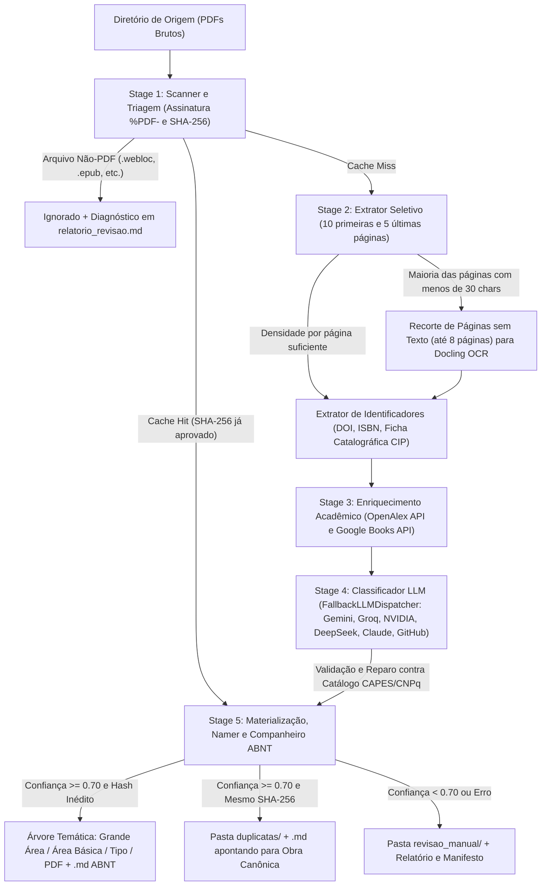

# Tomus: Organizador Acadêmico de PDFs

* **Author:** Dario
* **Date:** 2026-11-06
* **Version:** 0.4.0
* **Status:** Approved

## The Problem

Estudantes, professores e pesquisadores acumulam centenas de arquivos PDF (livros, artigos científicos, fascículos de periódicos, teses, dissertações, TCCs e materiais de aula) baixados de diferentes portais acadêmicos, repositórios institucionais e pastas compartilhadas. Esses arquivos chegam com nomes arbitrários (como códigos numéricos de submissão, siglas ou títulos truncados), frequentemente não possuem metadados internos padronizados e, no caso de obras antigas ou digitalizadas, consistem apenas em imagens escaneadas sem camada de texto selecionável.

Organizar esse acervo manualmente exige abrir cada arquivo, identificar autor, título, ano, natureza da publicação e área do conhecimento, renomear o PDF e movê-lo para a pasta correspondente. À medida que a tomusa passa de dezenas para centenas de documentos, a triagem manual torna-se inviável e propensa a inconsistências.

As soluções existentes não resolvem esse fluxo diretamente no sistema de arquivos:
1. Gerenciadores bibliográficos (como Zotero e Calibre) exigem a manutenção de um banco de dados próprio e focam em metadados de citação, sem classificar automaticamente o acervo em uma árvore física de diretórios baseada nas áreas oficiais do conhecimento acadêmico brasileiro.
2. Organizadores baseados em regras fixas (como `organize-tool`) dependem de expressões regulares e metadados já preenchidos, falhando quando o arquivo não traz informações estruturadas ou quando é necessário compreender o tema da obra.
3. Organizadores experimentais baseados em modelos de linguagem (como `llama-fs`) criam categorias livremente a cada execução, gerando pastas duplicadas ou conflitantes ao longo do tempo e falhando em documentos escaneados.

## Overview

O **Tomus** é uma aplicação que automatiza a triagem, classificação temática, padronização de nomes e organização física de tomusas acadêmicas de PDFs. O sistema recebe um diretório de origem contendo arquivos desorganizados e produz, em um diretório de destino, uma tomusa estruturada em três níveis hierárquicos baseados na Tabela de Áreas do Conhecimento da CAPES/CNPq:

`<Grande Área>/<Área Básica>/<Tipo>/<autor> - <titulo> - <subtitulo> - <ano>.pdf`

Onde `<Tipo>` pertence ao conjunto fechado `{Livro, Revista Científica, Artigo, Tese_Dissertacao, Outros}`.

Para atingir esse objetivo sem depender de leitura manual nem permitir que o modelo de linguagem invente pastas fora do padrão, o Tomus combina:
* **Extração seletiva de texto e OCR local sob demanda:** Leitura das páginas iniciais e finais do PDF (onde se concentram capa, folha de rosto, resumo, ficha catalográfica ABNT/CIP e colofão), acionando OCR local (via Docling) apenas nas páginas sem texto dessa janela quando o arquivo é escaneado.
* **Enriquecimento e validação externa:** Consulta a bases acadêmicas abertas (OpenAlex e Google Books) a partir de identificadores extraídos (DOI, ISBN) ou busca validada por título e autor.
* **Classificação multi-provedor controlada por esquema fechado:** Uso de modelos de linguagem abstraídos pelo protocolo `LLMProvider`, com suporte nativo a seis provedores (`gemini`, `groq`, `nvidia`, `deepseek`, `claude` e `github`), chaveamento automático em cadeia (`FallbackLLMDispatcher`), schema JSON explícito unificado e validação estrita contra o catálogo oficial da CAPES/CNPq.
* **Catalogação ABNT e segurança operacional no sistema de arquivos:** Operação padrão por cópia (com opção explícita de movimentação), geração de arquivo companheiro Markdown (`.md`) com referência ABNT NBR 6023 para cada obra organizada, isolamento de duplicatas exatas na pasta `duplicatas/`, modo de simulação (`--dry-run`), retomada de sessão interrompida (`tomus resume`), cache local por hash (`SHA-256`) e envio de documentos de baixa confiança para `revisao_manual/` acompanhados de relatório de auditoria e diagnóstico de arquivos não-PDF.

A arquitetura separa o motor central (`tomus.core`, `tomus.extractors`, `tomus.storage`) da interface de linha de comando (`tomus.cli`), preparando uma fronteira estável, thread-safe e com suporte a cancelamento cooperativo para o acoplamento da Desktop GUI (`v1.0.0`).

## Goals

* **Classificação acadêmica padronizada (CAPES/CNPq):** Organizar automaticamente PDFs válidos na estrutura `<Grande Área>/<Área Básica>/<Tipo>`, garantindo que 100% das pastas criadas pertençam ao catálogo fechado da CAPES/CNPq e aos cinco tipos documentais definidos (`Livro`, `Revista Científica`, `Artigo`, `Tese_Dissertacao`, `Outros`).
* **Meta de precisão e controle de triagem manual:** Atingir no mínimo **80% de acerto** na classificação dos PDFs válidos do conjunto de referência (`repositorio_de_pdfs_para_testes`), mantendo o volume de arquivos enviados para `revisao_manual/` dentro de um teto máximo de **15% a 20%** dos PDFs válidos.
* **Suporte a PDFs nativos e escaneados com tempo previsível:** Extrair metadados e texto de documentos digitais e digitalizados sem processar o OCR de livros inteiros de centenas de páginas, limitando a janela de inspeção às páginas iniciais e finais.
* **Padronização determinística de nomes e fichas companheiras ABNT:** Renomear os arquivos organizados para o formato `<autor> - <titulo> - <subtitulo> - <ano>.pdf` (respeitando o limite máximo de **240 bytes UTF-8**) e gerar ao lado de cada PDF um arquivo `.md` com Front Matter YAML e referência bibliográfica formatada segundo a ABNT NBR 6023.
* **Preservação dos arquivos originais e auditabilidade completa:** Copiar arquivos por padrão (movendo apenas quando instruído por flag), encaminhar duplicatas exatas para `duplicatas/`, diagnosticar arquivos não-PDF (como `.webloc`, `.url`, `.epub`) em relatório dedicado, evitar sobrescrita de arquivos distintos (inclusive em `revisao_manual/`) e gerar um manifesto JSON detalhado.
* **Arquitetura multi-provedor resiliente e pronta para GUI:** Isolar o motor de processamento da camada de apresentação, oferecer suporte a múltiplos provedores de LLM com fallback automático e expor eventos tipados (`PipelineEvent`) e cancelamento cooperativo (`cancel_event`) para consumo pela CLI e pela futura Desktop GUI (`v1.0.0`).

## Non-Goals

* **Interface gráfica (GUI) antes da consolidação do motor (`v0.4.0`):** As entregas até a `v0.4.0` focam na consolidação do motor de classificação, da cadeia multi-provedor e da CLI antes da construção da Desktop GUI na `v1.0.0`.
* **Dependência de SDKs proprietários pesados para cada provedor de LLM:** O suporte a provedores adicionais compatíveis com OpenAI e Anthropic (`groq`, `nvidia`, `deepseek`, `claude`, `github`) é implementado diretamente sobre `httpx` REST, evitando inflar a árvore de dependências do projeto com múltiplos SDKs externos.
* **OCR integral ou indexação full-text:** O sistema não fará OCR do corpo completo de livros escaneados nem construirá um motor de busca textual sobre o conteúdo integral das obras.
* **Gerenciamento de banco de dados próprio ou leitura de PDF:** O Tomus opera diretamente sobre a árvore do sistema de arquivos e arquivos `.md` companheiros, sem substituir leitores de PDF ou plugins de citação para processadores de texto.
* **Alteração binária interna dos PDFs:** O sistema não reescreverá metadados XMP/Info dentro do binário do arquivo PDF nem modificará seu conteúdo visual.

## Technical Plan

### 1. Arquitetura do Sistema e Fluxo de Dados

O sistema é organizado em três pacotes de domínio independentes de interface (`tomus.core`, `tomus.extractors`, `tomus.storage`) e um pacote de apresentação (`tomus.cli`), que consome os eventos do motor e exibe o progresso em tempo real sem poluir o terminal com logs de tomusas externas.



### 2. Estágios do Pipeline Principal

#### Stage 1: Scanner, Validação Binária e Cache
* **Filtro de Entrada e Exclusão de Destino:** Varre o diretório de origem de forma **recursiva por padrão** (`--recursive`), permitindo modo plano opcional (`--flat`). Antes de iniciar, resolve os caminhos absolutos de `SOURCE_DIR` e `TARGET_DIR`, rejeita execuções onde `SOURCE_DIR == TARGET_DIR` e exclui automaticamente a subárvore de `TARGET_DIR` caso ela esteja contida dentro de `SOURCE_DIR`. Ignora arquivos ocultos (avaliados pelo caminho relativo a `SOURCE_DIR`) e registra extensões diferentes de `.pdf` como `ignored_non_pdf`.
* **Verificação de Cabeçalho:** Valida a assinatura binária `%PDF-` nos primeiros 1024 bytes do arquivo. Arquivos com extensão `.pdf` corrompidos ou inválidos são registrados como erro e encaminhados para `revisao_manual/`.
* **Cache de Idempotência (SQLite):** Calcula o hash `SHA-256` em blocos de 64 KB e consulta o banco local em `~/.cache/tomus/state.db` (modo WAL, `check_same_thread=False`) pela chave composta `(sha256, taxonomy_version, model_name)`. Apenas classificações aprovadas (`confidence_score >= confidence_min`) são persistidas (registrando o `model_name` efetivo que realizou a classificação), e resultados de testes (`reasoning == "mock"`) nunca são lidos ou gravados no banco real do usuário.

#### Stage 2: Extração Seletiva de Texto e Fallback de OCR
* **Inspeção Nativa:** Extrai o texto das **10 primeiras páginas** e das **5 últimas páginas** do PDF (sem duplicar páginas em documentos curtos), além dos metadados internos e contagem total de páginas.
* **Priorização de Ficha Catalográfica (CIP):** Identifica páginas que contêm marcadores de catalogação na publicação padrão ABNT (CIP, CDD, CDU, ISBN) e destaca esse conteúdo em um campo dedicado (`cip_text`) para preservação integral no orçamento do prompt.
* **Fallback de OCR Seletivo por Página (Docling):** A densidade textual é medida **por página**: se mais da metade das páginas inspecionadas contiver menos de **30 caracteres alfanuméricos**, o extrator recorta em memória as páginas sem texto dentro da janela das **8 primeiras e 2 últimas páginas** (limitado a no máximo 8 páginas) e submete esse recorte ao `DocumentConverter` singleton do Docling.
* **Concorrência Controlada e Cancelamento Cooperativo:** Por padrão (`workers = 1`), o pipeline processa os arquivos sequencialmente. Quando `workers > 1`, as chamadas de rede (Stage 3 e Stage 4) ocorrem em paralelo via `ThreadPoolExecutor`, enquanto a extração/OCR e a persistência final (SQLite + Stage 5) permanecem serializadas por `finalize_lock` (`threading.RLock`). O orquestrador também aceita um `cancel_event: threading.Event | None` para interrupção cooperativa segura a partir da CLI ou da futura GUI.

#### Stage 3: Extração de Identificadores e Enriquecimento Acadêmico
* **Identificadores Validados:** Localiza candidatos a DOI por expressão regular estrita e candidatos a ISBN-10/ISBN-13 validando matematicamente o dígito verificador (`python-stdnum`), descartando números arbitrários presentes em nomes de arquivos.
* **Consultas ao OpenAlex e Google Books:**
  * Consultas por DOI (OpenAlex, enviando o cabeçalho `User-Agent` com `mailto:` do Polite Pool quando `openalex_polite_email` estiver configurado) ou ISBN validado (Google Books) são aceitas como correspondência exata (`match_score = 1.0`).
  * Quando não há DOI ou ISBN, o sistema extrai candidatos distintos de título e autor (priorizando metadados nativos não genéricos ou linhas distintas do texto amostrado) e só aceita o metadado retornado se a similaridade textual (`rapidfuzz.fuzz.token_set_ratio`) atingir no mínimo **88%**.
* **Tolerância a Falhas:** Requisições externas possuem timeout de 8 segundos e até 3 retentativas automáticas com backoff exponencial para falhas transitórias (HTTP 429, 5xx e timeouts de transporte), sem repetir erros permanentes de cliente (HTTP 404).

#### Stage 4: Classificação Multi-Provedor via LLM e Catálogo Fechado CAPES/CNPq
* **Catálogo CAPES/CNPq (`taxonomy_capes.json`):** Dicionário estático contendo a versão do catálogo (`version: "capes-cnpq-v1"`) e as **9 Grandes Áreas** oficiais da CAPES/CNPq mapeadas para suas respectivas **Áreas Básicas**.
* **Protocolo `LLMProvider`, Provedores Suportados e `FallbackLLMDispatcher`:**
  * O motor define o protocolo `LLMProvider` (retornando `ClassificationResult` com `provider_name` e `model_name` efetivos) e implementa 6 adaptadores de produção:
    1. `gemini` (`GeminiProvider` via `google-genai`, modelo padrão `gemini-3.5-flash` com fallback interno em HTTP 404 para `gemini-3.1-flash-lite`);
    2. `groq` (`GroqProvider` via `httpx`, modelo padrão `openai/gpt-oss-20b`);
    3. `nvidia` (`NvidiaProvider` via `httpx`, modelo padrão `nvidia/nemotron-3.5-lightning-30b-a3b`, `max_tokens=4096` e extração de fallback via `reasoning_content`);
    4. `deepseek` (`DeepSeekProvider` via `httpx`, modelo padrão `deepseek-flash`);
    5. `claude` (`ClaudeProvider` via `httpx`, modelo padrão `claude-3-5-haiku-20241022`);
    6. `github` (`GitHubModelsProvider` via `httpx`, modelo padrão `gpt-4o`).
  * A fábrica `create_provider_chain` monta o `FallbackLLMDispatcher` colocando o provedor solicitado como primário e encadeando os demais provedores configurados em `fallback_chain = ["groq", "nvidia", "deepseek"]` que possuam chave de API válida.
  * O prompt de sistema (`build_system_prompt`) inclui o schema JSON explícito completo com todos os 9 campos obrigatórios (`[SCH-01]`), garantindo a mesma precisão estrutural em provedores OpenAI-compatíveis e no Gemini. O payload contextual trunca `sampled_text` em no máximo **15.000 caracteres**, preservando `cip_text` integralmente.
* **Validação da Taxonomia e Regras de Tipo:**
  * `validate_or_repair_pair` garante que `grande_area` e `area_basica` pertençam ao catálogo oficial, corrigindo automaticamente a `grande_area` pai quando `area_basica` existir em outra Grande Área, ou forçando `confidence_score = 0.0` quando ambas forem inválidas.
  * O campo `tipo` admite exclusivamente cinco valores: `Livro`, `Revista Científica`, `Artigo`, `Tese_Dissertacao` e `Outros`.
* **Travas Determinísticas de Confiança (`confidence_score`):**
  * Se o texto alfanumérico útil total for inferior a **50 caracteres** e não houver metadados externos, ocorre *short-circuit* antes da chamada de rede (`confidence_score = 0.0`).
  * Se o título retornado for vazio ou genérico sem autor identificável, a confiança máxima é limitada a `0.50`.
  * Arquivos com `confidence_score >= confidence_min` (`0.70` por padrão) seguem para a árvore temática; arquivos abaixo do limiar vão para `revisao_manual/`.

#### Stage 5: Padronização de Nomes, Materialização, Arquivos Companheiros e Auditoria
* **Regras de Nomeação (Arquivos Aprovados):**
  * **Autores:** `Sobrenome, Nome` (1 autor), `Sobrenome1; Sobrenome2` (2 autores), `Sobrenome1 et al.` (3+ autores), ou `Autor Desconhecido`.
  * **Composição e Truncamento:** `<autor> - <titulo> - <subtitulo> - <ano>.pdf` (omitindo `<subtitulo>` quando vazio e usando `s.d.` quando o ano for `None`), normalizado em Unicode NFC, sanitizado contra caracteres proibidos (`/ \ : * ? " < > |`) e truncado em fronteira de palavra dentro do limite de **240 bytes UTF-8**.
* **Materialização, Arquivos Companheiros (`.md`), `duplicatas/` e `revisao_manual/`:**
  * Copia os arquivos por padrão (`--copy`) ou move de forma segura (`shutil.copy2` seguido de `unlink`) mediante `--move`. No modo `--dry-run`, nenhuma pasta temática ou de duplicatas é criada e nenhum PDF ou `.md` companheiro é gravado, mantendo o rastreamento de colisões em memória (`_planned_destinations`) e gravando apenas os artefatos de auditoria (`manifest.json` e `revisao_manual/relatorio_revisao.md`).
  * **Arquivo Companheiro ABNT (`companion.py`):** Ao lado de cada PDF organizado na árvore temática, é gravado um arquivo `<nome_formatado>.md` contendo Front Matter YAML, data local humanizada (`DD/MM/YYYY HH:MM:SS`), citação bibliográfica formatada segundo a ABNT NBR 6023 e resumo da classificação.
  * **Resolução de Colisões e Pasta `duplicatas/`:** Tanto na árvore temática quanto em `revisao_manual/` e `duplicatas/`, colisões de nome são verificadas pelo hash `SHA-256` (reutilizando o hash calculado no Stage 1). Na árvore temática, duplicatas exatas (`duplicate_skipped`) são encaminhadas para `<TARGET_DIR>/duplicatas/` acompanhadas de um arquivo `.md` que referencia a obra canônica; já arquivos de conteúdo distinto (tanto na árvore temática quanto em `revisao_manual/`) recebem sufixo incremental ` (2).pdf`, impedindo qualquer sobrescrita silenciosa.
* **Auditoria e Diagnóstico de Não-PDFs (`[DIAG-06]`):** Gera no destino o manifesto completo (`manifest.json`) e o relatório `revisao_manual/relatorio_revisao.md`, que inclui tanto os PDFs pendentes de revisão humana quanto a seção `## Arquivos Não-PDF e Atalhos Ignorados` com diagnóstico tipado por extensão (`.webloc`, `.url`, `.epub`, `.docx`, imagens, etc.).

### 3. Entidades de Domínio e Contratos de Dados

| Entidade / Contrato | Responsabilidade | Campos Principais |
| :--- | :--- | :--- |
| **`ExtractedDocument`** | Resultado da leitura local do PDF (Stage 1 e Stage 2). | `source_path`, `sha256`, `file_size_bytes`, `total_pages`, `used_ocr`, `native_metadata`, `sampled_text`, `cip_text`, `detected_doi`, `detected_isbn` |
| **`ExternalMetadata`** | Metadados recuperados e validados do OpenAlex ou Google Books (Stage 3). | `source` (`openalex` \| `google_books`), `title`, `subtitle`, `authors`, `publication_year`, `document_type_hint`, `concepts`, `match_score` |
| **`LLMClassificationOutput`** | Schema Pydantic de validação da resposta JSON do LLM (Stage 4). | `grande_area`, `area_basica`, `tipo` (`DocumentType`), `authors` (`list[str]`), `title`, `subtitle`, `year`, `confidence_score` (`0.0..1.0`), `reasoning` |
| **`ClassificationResult`** | Dataclass retornado por `LLMProvider.classify` após travas determinísticas e reparo CAPES (Stage 4). | `grande_area`, `area_basica`, `tipo`, `authors`, `title`, `subtitle`, `year`, `confidence_score`, `reasoning`, `used_ocr`, `provider_name`, `model_name` |
| **`FileManifestEntry`** | Registro individual auditável gravado em `manifest.json` (Stage 5). | `source_path`, `destination_path`, `sha256`, `status` (`organized`, `manual_review`, `duplicate_skipped`, `ignored_non_pdf`, `error`), `used_ocr`, `classification`, `error_message` |
| **`ExecutionSummary`** | Envelope raiz gravado em `manifest.json` e exibido ao final da execução. | `total_scanned`, `organized_count`, `manual_review_count`, `duplicate_skipped_count`, `ignored_non_pdf_count`, `error_count`, `manual_review_ratio`, `exceeded_manual_review_ceiling`, `entries` (`list[FileManifestEntry]`) |
| **`PipelineEvent`** | Evento thread-safe emitido pelo orquestrador para atualizar a CLI ou futura GUI. | `stage`, `source_path`, `status`, `message`, `total_files`, `completed_files`, `timestamp` |
| **`SessionState`** | Estado persistido em `.tomus_session.json` para retomada via `tomus resume`. | `source_dir`, `target_dir`, `recursive`, `move`, `dry_run`, `provider`, `model`, `confidence_min`, `workers`, `no_cache`, `created_at` |

### 4. Arquivo de Configuração (`config.toml`) e Regras de Precedência

O Tomus utiliza um arquivo de configuração **TOML** gerenciado via `pydantic-settings` com filtro de strings vazias (`FilteredTomlSettingsSource`), garantindo que campos em branco no template não anulem variáveis de ambiente:

* **Ordem de Precedência (da maior para a menor prioridade):**
  1. Flags passadas diretamente na CLI (ex.: `--provider`, `--model`, `--api-key`, `--move`, `--flat`).
  2. Variáveis de ambiente:
     * Gemini: `TOMUS_GEMINI_API_KEY` > `GEMINI_API_KEY`
     * Groq: `TOMUS_GROQ_API_KEY` > `GROQ_API_KEY`
     * NVIDIA NIM: `TOMUS_NVIDIA_API_KEY` > `NVIDIA_API_KEY`
     * DeepSeek: `TOMUS_DEEPSEEK_API_KEY` > `DEEPSEEK_API_KEY`
     * Anthropic Claude: `TOMUS_CLAUDE_API_KEY` > `CLAUDE_API_KEY` > `ANTHROPIC_API_KEY`
     * GitHub Models: `TOMUS_GITHUB_TOKEN` > `GITHUB_TOKEN` > `GH_TOKEN`
     * Serviços acadêmicos: `TOMUS_GOOGLE_BOOKS_API_KEY` > `GOOGLE_BOOKS_API_KEY` e `TOMUS_OPENALEX_POLITE_EMAIL` > `OPENALEX_POLITE_EMAIL`
  3. Arquivo de configuração local no diretório atual (`./tomus.toml`) ou indicado via `--config <caminho>`.
  4. Arquivo de configuração global do usuário (`~/.config/tomus/config.toml`), gerado com permissão restrita (`0600`) pelo comando `tomus config init`.

```toml
# ~/.config/tomus/config.toml (ou ./tomus.toml)

[general]
# Modo de varredura da pasta de origem: true = recursivo (padrão), false = plano
recursive = true
# Operação padrão nos arquivos: "copy" (copiar) ou "move" (mover)
file_operation = "copy"
# Limiar mínimo de confiança (0.0 a 1.0) para organizar automaticamente
confidence_min = 0.70
# Número de workers (1 = execução sequencial padrão segura para OCR e SQLite)
workers = 1
# Ativar cache local SQLite por SHA-256 (~/.cache/tomus/state.db)
use_cache = true

[llm]
# Provedor primário de classificação ("gemini", "groq", "nvidia", "deepseek", "claude", "github")
provider = "gemini"
default_provider = "gemini"
# Cadeia de fallback automático quando o provedor primário falha
fallback_chain = ["groq", "nvidia", "deepseek"]
# Modelo padrão do provedor primário
model = "gemini-3.5-flash"

# Configurações opcionais de modelo por provedor:
# [llm.providers.groq]
# model = "openai/gpt-oss-20b"
# [llm.providers.nvidia]
# model = "nvidia/nemotron-3.5-lightning-30b-a3b"
# [llm.providers.deepseek]
# model = "deepseek-flash"

[api_keys]
# Chaves de API dos provedores de LLM e serviços de busca acadêmica
gemini_api_key = ""
google_books_api_key = ""
openalex_polite_email = ""
nvidia_api_key = ""
deepseek_api_key = ""
claude_api_key = ""
groq_api_key = ""
github_token = ""
```

### 5. Contrato da CLI (`tomus`)

```text
Uso Principal (Invocação Direta na Raiz ou via Subcomando):
  tomus -o <SOURCE_DIR> -d <TARGET_DIR> [OPTIONS]
  tomus organize <SOURCE_DIR> <TARGET_DIR> [OPTIONS]   (alias compatível oculto no --help raiz)

Comandos de Sessão, Configuração e Cache:
  tomus resume [--verbose / -v]    Retoma a última execução interrompida (.tomus_session.json)
  tomus config init [--local]      Cria o arquivo config.toml comentado (permissão 0600)
  tomus config show                Exibe a configuração ativa (mascarando chaves de API)
  tomus config path                Exibe o caminho do arquivo de configuração ativo
  tomus cache clean | clear        Remove o banco SQLite de cache (~/.cache/tomus/state.db)
  tomus cache status               Exibe caminho, tamanho em KB e total de arquivos em cache
  tomus cache path                 Exibe o caminho do banco SQLite de cache

Opções de Organização:
  -o, --origem, --source PATH          Diretório de origem contendo os PDFs brutos
  -d, --destino, --target PATH         Diretório de destino da tomusa organizada
  -p, --provider TEXT                  Provedor LLM: gemini, groq, nvidia, deepseek, claude, github
  --model TEXT                         Nome do modelo LLM (sobrescreve config.toml)
  --api-key TEXT                       Chave de API do provedor (sobrescreve config.toml e ambiente)
  --google-books-key TEXT              Chave de API do Google Books (sobrescreve config.toml)
  --config PATH                        Caminho para um arquivo config.toml customizado
  --recursive / --flat                 Varrer subpastas recursivamente ou apenas nível raiz (Padrão: --recursive)
  --move / --copy                      Mover arquivos com segurança em vez de copiar (Padrão: --copy)
  --dry-run                            Simula a organização e gera manifest.json sem copiar/mover PDFs
  --confidence-min FLOAT               Limiar mínimo para organização automática (Padrão: 0.70)
  --no-cache                           Ignora o cache SQLite local e reprocessa todos os arquivos
  --workers INT                        Concorrência para chamadas de rede (Padrão: 1)
  -v, --verbose                        Exibe logs detalhados de diagnóstico no terminal (além de tomus.log)
```

## Alternatives Considered

### 1. Gerenciadores Bibliográficos Tradicionais (Zotero com ZotMoov/Attanger ou Calibre)
* **Descrição:** Utilizar o Zotero ou o Calibre como motor principal para importar os PDFs, buscar metadados em bases acadêmicas e mover os arquivos no disco por meio de plugins de renomeação e pastas.
* **Decisão:** Rejeitada: Embora extraiam metadados de livros e artigos com DOI/ISBN, essas ferramentas exigem manter um banco de dados próprio de gerenciador de referências, falham na extração automática de documentos brasileiros informais (como TCCs sem DOI, apostilas e slides de aula) e não classificam automaticamente o acervo em uma árvore física estrita de `<Grande Área>/<Área Básica>/<Tipo>` baseada na Tabela CAPES/CNPq.

### 2. Organizadores de Arquivos Baseados em Categorias Abertas por LLM (`llama-fs`)
* **Descrição:** Utilizar o projeto `llama-fs` para ler trechos dos PDFs e permitir que o modelo de linguagem proponha livremente a estrutura de diretórios e os nomes dos arquivos.
* **Decisão:** Rejeitada: Como o modelo inventa os nomes das pastas a cada execução com base apenas na amostra do lote atual, ocorrem variações constantes de nomenclatura e deriva de taxonomia ao longo do tempo (ex.: criação de pastas concorrentes como `Psicologia`, `Psicologia_Clinica` e `Artigos_Psicologia`). Além disso, o `llama-fs` não aplica distinção formal entre os tipos documentais acadêmicos exigidos (`Livro`, `Revista Científica`, `Artigo`, `Tese_Dissertacao`, `Outros`) e não possui fallback seletivo de OCR para PDFs escaneados.

### 3. Organizadores Baseados Exclusivamente em Regras Determinísticas (`organize-tool`)
* **Descrição:** Configurar regras declarativas em YAML no `organize-tool` inspecionando metadados internos do PDF, número de páginas e expressões regulares no texto.
* **Decisão:** Rejeitada: Regras fixas e expressões regulares não conseguem inferir semanticamente a Grande Área e a Área Básica da CAPES/CNPq a partir do conteúdo textual de livros, artigos e teses, nem conseguem normalizar títulos, subtítulos e autores quando os metadados internos do PDF estão vazios ou corrompidos.

### 4. Execução do Docling OCR no Documento PDF Inteiro
* **Descrição:** Passar o arquivo PDF completo diretamente para o `DocumentConverter` do Docling sempre que o documento precisar de extração textual ou OCR.
* **Decisão:** Rejeitada: A pasta de referência contém livros digitalizados de mais de 30 MB e centenas de páginas. Executar OCR e análise de layout página por página no livro inteiro consome gigabytes de RAM e vários minutos por arquivo, sendo que os elementos necessários para classificação e catalogação (capa, folha de rosto, ficha catalográfica ABNT/CIP, sumário, resumo e colofão) concentram-se nas páginas iniciais e finais.

### 5. Mapeamento CAPES/CNPq Usando `Área Básica / Subárea` em vez de `Grande Área / Área Básica`
* **Descrição:** Utilizar o segundo e o terceiro níveis da tabela CAPES/CNPq (`Área Básica` como primeiro nível de pasta e `Subárea` como segundo nível) em vez do primeiro e segundo níveis (`Grande Área / Área Básica`).
* **Decisão:** Rejeitada: A tabela CAPES/CNPq possui centenas de subáreas detalhadas. Adotar `Subárea` como pasta física fragmentaria acervos de médio porte (~100 a 500 PDFs) em dezenas de micro-pastas contendo apenas um ou dois arquivos e aumentaria a ambiguidade de classificação para obras interdisciplinares.

## Detailed Implementation

Abaixo está o inventário completo dos módulos de produção, configuração e testes que compõem o Tomus na versão `v0.4.0`, detalhando as responsabilidades e contratos de cada arquivo:

1. **[pyproject.toml](../../pyproject.toml) (Implementado — v0.4.0)**
   * **Responsabilidade:** Define os metadados do pacote Python (`tomus`, versão `0.4.0`, Python $\ge 3.11$), o sistema de build (`hatchling`), o ponto de entrada executável (`tomus = "tomus.cli.main:app"`), as dependências de produção (`pymupdf`, `docling`, `httpx`, `tenacity`, `rapidfuzz`, `python-stdnum`, `pydantic`, `pydantic-settings`, `google-genai`, `typer`, `rich`, `tomli-w`), as dependências de desenvolvimento (`pytest`, `respx`, `ruff`) e a seção `[tool.pytest.ini_options]` com o marcador `slow` e filtros de avisos (`filterwarnings`).
   * **Por que é necessário:** Padroniza a instalação reproduzível do ambiente, registra o executável `tomus` e configura a suíte de testes.

2. **[.gitignore](../../.gitignore) (Implementado — v0.4.0)**
   * **Responsabilidade:** Ignora ambientes virtuais (`.venv/`), caches Python (`__pycache__/`, `.pytest_cache/`, `.ruff_cache/`), arquivos de sistema (`.DS_Store`), bancos SQLite locais (`*.db`), logs e arquivos de sessão (`tomus.log`, `.tomus_session.json`) e arquivos de configuração local contendo chaves privadas (`tomus.toml`, `.env`).
   * **Por que é necessário:** Impede o versionamento acidental de chaves de API privadas, caches binários e artefatos temporários de execução.

3. **[README.md](../../README.md) e [CHANGELOG.md](../../CHANGELOG.md) (Implementados — v0.4.0)**
   * **Responsabilidade:** `README.md` documenta a instalação, configuração multi-provedor via `tomus config init`, exemplos de invocação direta (`tomus -o ... -d ...`), retomada (`tomus resume`) e gerenciamento de cache (`tomus cache`). `CHANGELOG.md` registra o histórico semântico de entregas desde a `v0.0.1` até a `v0.4.0`.
   * **Por que é necessário:** Fornece documentação operacional atualizada e rastreabilidade de mudanças entre versões.

4. **[src/tomus/__init__.py](../../src/tomus/__init__.py) (Implementado — v0.4.0)**
   * **Responsabilidade:** Define `__version__ = "0.4.0"`, configura variáveis de ambiente defensivas (`HF_HUB_DISABLE_PROGRESS_BARS = "1"`, `TOKENIZERS_PARALLELISM = "false"`) e aplica filtros `warnings.filterwarnings` para silenciar avisos de tomusas externas (`google.*`, `fitz.*`, `urllib3`, `SwigPy`/`swigvarlink`, `torch.*`) no carregamento do pacote.
   * **Por que é necessário:** Centraliza a versão do pacote (consumida pelo cabeçalho `User-Agent` em `enrichers.py`) e garante inicialização silenciosa no terminal.

5. **[src/tomus/core/__init__.py](../../src/tomus/core/__init__.py) (Implementado — v0.4.0)**
   * **Responsabilidade:** Exporta em `__all__` as entidades de domínio (`models.py`), funções de taxonomia (`taxonomy.py`), configuração (`AppConfig`), scanner (`scan_directory`), cache (`FileCache`), logging (`setup_logging`, `get_logger`), sessão (`SessionState`, `save_session`, `load_session`, `clear_session`, `SESSION_FILE`), prompts (`build_system_prompt`, `build_context_payload`, `is_generic_title`, `format_authors_for_filename`) e componentes de LLM (`LLMProvider`, `GeminiProvider`, `NvidiaProvider`, `DeepSeekProvider`, `ClaudeProvider`, `GroqProvider`, `GitHubModelsProvider`, `MockLLMProvider`, `FallbackLLMDispatcher`, `create_provider_chain`, `ClassificationResult`).
   * **Por que é necessário:** Isola o pacote `core` de dependências da camada de apresentação (`typer`, `rich`) e expõe uma fachada unificada para a CLI e futura GUI.

6. **[src/tomus/core/config.py](../../src/tomus/core/config.py) (Implementado — v0.4.0)**
   * **Responsabilidade:** Define `AppConfig(BaseSettings)` composto por `general: GeneralConfig`, `llm: LLMConfig` (com `provider`/`default_provider`, `fallback_chain = ["groq", "nvidia", "deepseek"]`, `model = "gemini-3.5-flash"` e `providers: dict[str, dict[str, Any]]`) e `api_keys: ApiKeysConfig` (com `AliasChoices` para as 8 credenciais: Gemini, Google Books, OpenAlex, NVIDIA, DeepSeek, Claude, Groq e GitHub). Implementa `FilteredTomlSettingsSource` (`LocalTomlSettingsSource` e `GlobalTomlSettingsSource`) para remover strings vazias (`""`) antes da mesclagem de fontes (`init_settings -> env_settings -> local_toml -> global_toml`), além de `generate_config_template` (permissão `0600`) e `mask_config_for_display`.
   * **Por que é necessário:** Garante a precedência exata entre flags de CLI, variáveis de ambiente e arquivos TOML sem que chaves vazias no template sobrescrevam variáveis de ambiente.

7. **[src/tomus/core/models.py](../../src/tomus/core/models.py) (Implementado — v0.4.0)**
   * **Responsabilidade:** Declara os enumeradores (`DocumentType`, `ProcessStatus`, `FileOperation`) e os modelos Pydantic (`ExtractedDocument`, `ExternalMetadata`, `LLMClassificationOutput`, `FileManifestEntry`, `ExecutionSummary` e `PipelineEvent` com `total_files`, `completed_files` e `timestamp`).
   * **Por que é necessário:** Fornece contratos de dados validados entre os 5 estágios do pipeline e telemetria estruturada para barras de progresso na CLI e futura GUI.

8. **[src/tomus/core/resources/taxonomy_capes.json](../../src/tomus/core/resources/taxonomy_capes.json) (Implementado — v0.4.0)**
   * **Responsabilidade:** Define o dicionário canônico no formato `{"version": "capes-cnpq-v1", "areas": {"Grande Área": ["Área Básica", ...]}}` contendo as 9 Grandes Áreas da CAPES/CNPq e suas Áreas Básicas em português.
   * **Por que é necessário:** Fornece o catálogo fechado para validar as pastas `<Grande Área>/<Área Básica>` e a string `taxonomy_version` usada na chave do cache.

9. **[src/tomus/core/taxonomy.py](../../src/tomus/core/taxonomy.py) (Implementado — v0.4.0)**
   * **Responsabilidade:** Carrega `taxonomy_capes.json` com cache em memória e expõe `get_taxonomy_version() -> str`, `get_grandes_areas() -> list[str]`, `get_areas_basicas(grande_area: str) -> list[str]`, `validate_or_repair_pair(grande_area: str, area_basica: str) -> tuple[str, str] | None` e `format_taxonomy_for_prompt() -> str`.
   * **Por que é necessário:** Centraliza a validação e o reparo determinístico da taxonomia CAPES/CNPq.

10. **[src/tomus/core/scanner.py](../../src/tomus/core/scanner.py) (Implementado — v0.4.0)**
    * **Responsabilidade:** Define `ScannedFile`, `ScanResult` e `scan_directory(source_dir, target_dir, recursive=True)`: resolve caminhos absolutos, rejeita `source_dir == target_dir`, exclui a subárvore de `target_dir`, ignora arquivos ocultos relativos a `source_dir`, separa extensões não-PDF em `ignored_non_pdf`, valida a assinatura `%PDF-` nos primeiros 1024 bytes e calcula `SHA-256` em blocos de 64 KB.
    * **Por que é necessário:** Previne recursão infinita sobre a pasta de destino, filtra arquivos não-PDF e identifica PDFs corrompidos antes da extração.

11. **[src/tomus/core/cache.py](../../src/tomus/core/cache.py) (Implementado — v0.4.0)**
    * **Responsabilidade:** Implementa `FileCache(enabled=True, db_path=None)` sobre `~/.cache/tomus/state.db` em modo `WAL` e `check_same_thread=False`, indexado por `(sha256, taxonomy_version, model_name)`. Persiste apenas classificações com `confidence_score >= confidence_min`, expõe `get()`, `put()`, `clear()` e `close()`, e bloqueia leitura/gravação de entradas de teste (`reasoning == "mock"`) quando opera no banco real (`db_path is None`).
    * **Por que é necessário:** Garante idempotência thread-safe sem persistir no cache falhas transitórias ou dados simulados de testes.

12. **[src/tomus/core/logging.py](../../src/tomus/core/logging.py) (Implementado — v0.4.0)**
    * **Responsabilidade:** Implementa `setup_logging(log_file="tomus.log", verbose=False, level=logging.INFO)` e `get_logger(name)`: define variáveis de ambiente defensivas (`GLOG_minloglevel="2"`, `TORCH_CPP_LOG_LEVEL="ERROR"`), redireciona logs de tomusas externas (`RapidOCR`, `docling`, `transformers`, `torch`, `urllib3`, `httpx`, `fitz`) para `tomus.log` e anexa `StreamHandler` ao console apenas quando `verbose=True`.
    * **Por que é necessário:** Mantém a renderização da barra de progresso do Rich livre de interferências no terminal, preservando o rastreamento completo em arquivo.

13. **[src/tomus/core/session.py](../../src/tomus/core/session.py) (Implementado — v0.4.0)**
    * **Responsabilidade:** Define `SESSION_FILE = Path(".tomus_session.json")`, o modelo Pydantic `SessionState` e as funções `save_session`, `load_session` e `clear_session`.
    * **Por que é necessário:** Permite retomar execuções interrompidas via `tomus resume` sem redigitar parâmetros de linha de comando.

14. **[src/tomus/extractors/__init__.py](../../src/tomus/extractors/__init__.py) (Implementado — v0.4.0)**
    * **Responsabilidade:** Expõe `extract_document_content(path: Path, sha256: str) -> ExtractedDocument`, coordenando a leitura nativa, a decisão de fallback para OCR seletivo e a extração de identificadores.
    * **Por que é necessário:** Encapsula o Stage 2 sob uma única função de alto nível para o orquestrador.

15. **[src/tomus/extractors/identifiers.py](../../src/tomus/extractors/identifiers.py) (Implementado — v0.4.0)**
    * **Responsabilidade:** Extrai DOIs por expressão regular, valida candidatos a ISBN-10/13 via `python-stdnum` (`stdnum.isbn.is_valid`) e detecta páginas de Ficha Catalográfica (CIP/CDD/CDU).
    * **Por que é necessário:** Garante que apenas DOIs e ISBNs matematicamente válidos sejam enviados às APIs externas e isola a Ficha Catalográfica.

16. **[src/tomus/extractors/native_pdf.py](../../src/tomus/extractors/native_pdf.py) (Implementado — v0.4.0)**
    * **Responsabilidade:** Utiliza `PyMuPDF` (`fitz`) para ler metadados internos e extrair texto das 10 primeiras e 5 últimas páginas, sinalizando necessidade de OCR quando mais da metade das páginas inspecionadas contiver menos de 30 caracteres alfanuméricos.
    * **Por que é necessário:** Inspeciona rapidamente documentos nativos e detecta PDFs escaneados sem ler centenas de páginas intermediárias.

17. **[src/tomus/extractors/ocr_docling.py](../../src/tomus/extractors/ocr_docling.py) (Implementado — v0.4.0)**
    * **Responsabilidade:** Recorta via `PyMuPDF` (`doc.insert_pdf`) as páginas sem texto dentro da janela das 8 primeiras e 2 últimas páginas (máximo de 8 páginas) em um buffer `io.BytesIO`, encapsula-o em `DocumentStream` e executa uma instância singleton do `DocumentConverter` do Docling.
    * **Por que é necessário:** Viabiliza o OCR de obras digitalizadas com consumo previsível de memória e tempo.

18. **[src/tomus/core/enrichers.py](../../src/tomus/core/enrichers.py) (Implementado — v0.4.0)**
    * **Responsabilidade:** Implementa `enrich_document_metadata(doc, config)` com consultas HTTP (`httpx` + `tenacity` retry de 3 tentativas para erros transitórios 429/5xx/timeout e timeout de 8s) para a OpenAlex API (incluindo `mailto:` no cabeçalho `User-Agent` tanto na busca por DOI quanto na busca por título) e para a Google Books API, aplicando validação `rapidfuzz.fuzz.token_set_ratio >= 88.0` nas buscas textuais com extração de candidatos distintos de título e autor.
    * **Por que é necessário:** Enriquece a classificação com metadados bibliográficos verificados sem interromper o pipeline em caso de falha de rede.

19. **[src/tomus/core/prompts.py](../../src/tomus/core/prompts.py) (Implementado — v0.4.0)**
    * **Responsabilidade:** Define `build_system_prompt()` (com regras de classificação CAPES/CNPq e especificação formal do schema JSON de 9 campos `[SCH-01]`), `build_context_payload()` (truncando `sampled_text` em 15.000 caracteres com prioridade integral para `cip_text`), `is_generic_title(title)` e `format_authors_for_filename(authors)`.
    * **Por que é necessário:** Padroniza o contrato de prompt e formatação de autores entre todos os 6 provedores de LLM e o formatador de nomes.

20. **[src/tomus/core/llm.py](../../src/tomus/core/llm.py) (Implementado — v0.4.0)**
    * **Responsabilidade:** Define `ClassificationResult` (incluindo `provider_name` e `model_name`), o protocolo `LLMProvider`, as funções centralizadas de validação determinística (`_check_short_circuit` e `_finalize_classification`), os 6 adaptadores de produção (`GeminiProvider`, `NvidiaProvider`, `DeepSeekProvider`, `ClaudeProvider`, `GroqProvider`, `GitHubModelsProvider`), `MockLLMProvider`, o despachante `FallbackLLMDispatcher` e a fábrica `create_provider_chain` (que respeita overrides da CLI, `[llm.providers.<nome>].model`, `config.llm.model` e variáveis de ambiente).
    * **Por que é necessário:** Fornece classificação multi-provedor resiliente com failover automático e travas determinísticas de confiança.

21. **[src/tomus/storage/__init__.py](../../src/tomus/storage/__init__.py) (Implementado — v0.4.0)**
    * **Responsabilidade:** Exporta `format_academic_filename`, `LibraryOrganizer` e `generate_companion_markdown`.
    * **Por que é necessário:** Expõe a interface pública do subpacote de armazenamento e materialização.

22. **[src/tomus/storage/namer.py](../../src/tomus/storage/namer.py) (Implementado — v0.4.0)**
    * **Responsabilidade:** Implementa `format_academic_filename` compondo `<autor> - <titulo> - <subtitulo> - <ano>.pdf` com normalização Unicode NFC, sanitização de caracteres proibidos e truncamento progressivo em fronteira de palavra dentro do orçamento de 240 bytes UTF-8.
    * **Por que é necessário:** Garante nomes de arquivo padronizados e compatíveis com os limites de sistemas de arquivos modernos.

23. **[src/tomus/storage/companion.py](../../src/tomus/storage/companion.py) (Implementado — v0.4.0)**
    * **Responsabilidade:** Implementa `format_abnt_author`, `format_abnt_authors`, `format_abnt_reference`, `generate_companion_markdown` (gerando arquivo `.md` com Front Matter YAML, data local humanizada `DD/MM/YYYY HH:MM:SS` e referência ABNT NBR 6023) e `generate_duplicate_companion_markdown` (gerando `.md` para duplicatas com referência à obra canônica).
    * **Por que é necessário:** Documenta cada PDF organizado e cada duplicata com metadados legíveis por humanos e ferramentas de indexação Markdown (ex.: Obsidian).

24. **[src/tomus/storage/organizer.py](../../src/tomus/storage/organizer.py) (Implementado — v0.4.0)**
    * **Responsabilidade:** Implementa `LibraryOrganizer` e `_resolve_collision` (reutilizando `src_sha256` e `_planned_destinations`): materializa PDFs aprovados e seus `.md` companheiros na árvore temática, encaminha duplicatas exatas (`duplicate_skipped`) para `<TARGET_DIR>/duplicatas/` com `.md` companheiro, resolve colisões de nomes distintos com sufixo ` (2).pdf` tanto na árvore temática quanto em `revisao_manual/` e `duplicatas/`, diagnostica arquivos não-PDF (`add_ignored_non_pdf`) e grava `manifest.json` e `revisao_manual/relatorio_revisao.md`.
    * **Por que é necessário:** Assegura integridade física dos arquivos sem sobrescritas silenciosas e produz relatórios completos de auditoria.

25. **[src/tomus/core/pipeline.py](../../src/tomus/core/pipeline.py) (Implementado — v0.4.0)**
    * **Responsabilidade:** Implementa `run_pipeline` conectando os 5 estágios com suporte a execução sequencial (`workers=1`) ou concorrente nas etapas de rede (`workers>1`, protegendo OCR, cache e organizer via `finalize_lock`), resolução automática da cadeia de provedores (`create_provider_chain`), persistência do `model_name` efetivo no cache, suporte a `dry_run` e `cancel_event: threading.Event | None` e emissão thread-safe de `PipelineEvent`.
    * **Por que é necessário:** Orquestra a execução sequencial e concorrente dos 5 estágios sem acoplamento com a interface de usuário.

26. **[src/tomus/cli/__init__.py](../../src/tomus/cli/__init__.py) e [src/tomus/cli/main.py](../../src/tomus/cli/main.py) (Implementados — v0.4.0)**
    * **Responsabilidade:** Expõe o aplicativo Typer com invocação direta na raiz (`tomus -o <origem> -d <destino>`), subcomando `organize` (`hidden=True`), `tomus resume`, subgrupos `tomus config {init,show,path}` e `tomus cache {clean,clear,status,path}`, painel duplo de progresso (`Rich Live` + `Group`) e resumo final com notificação de atalhos `.webloc` e arquivos não-PDF ignorados.
    * **Por que é necessário:** Expõe os comandos da CLI, o controle de sessão e a exibição de progresso no terminal.

27. **Suíte de Testes Automatizados (`tests/`) (Implementada — v0.4.0)**
    * **Responsabilidade:** Agrupa os testes unitários e de integração do projeto:
      * [tests/test_namer.py](../../tests/test_namer.py) e [tests/test_taxonomy_and_identifiers.py](../../tests/test_taxonomy_and_identifiers.py): validação de truncamento UTF-8 em 240 bytes, reparo CAPES/CNPq, DOI, ISBN e Ficha Catalográfica;
      * [tests/test_multi_provider.py](../../tests/test_multi_provider.py) e [tests/test_llm.py](../../tests/test_llm.py): testes dos 6 provedores (`Gemini`, `Groq`, `NVIDIA`, `DeepSeek`, `Claude`, `GitHub Models`), `FallbackLLMDispatcher` e travas de confiança;
      * [tests/test_cli_ergonomia.py](../../tests/test_cli_ergonomia.py), [tests/test_cli.py](../../tests/test_cli.py), [tests/test_resume.py](../../tests/test_resume.py) e [tests/test_logging.py](../../tests/test_logging.py): testes de invocação raiz `-o/-d`, retomada de sessão, subcomandos de cache e silenciamento de logs no terminal;
      * [tests/test_companion.py](../../tests/test_companion.py), [tests/test_organizer.py](../../tests/test_organizer.py) e [tests/test_pipeline_integration.py](../../tests/test_pipeline_integration.py): testes de citações ABNT, pasta `duplicatas/`, resolução de colisão em `revisao_manual/`, `cancel_event`, `--dry-run` e cache SQLite concorrente (`workers=4`).
    * **Por que é necessário:** Verifica continuamente os contratos dos 5 estágios, dos 6 provedores de LLM e da CLI sem depender de chamadas de rede reais.
